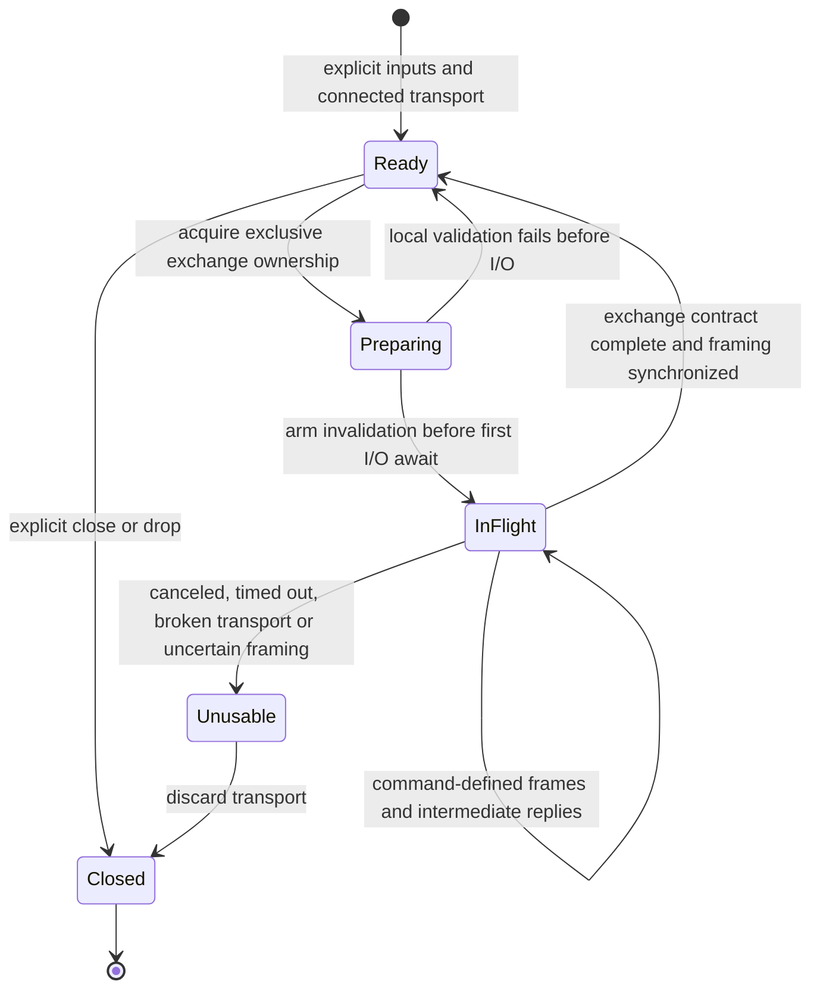

# A composable library with an explicit exchange lifecycle

## Standing and human direction

This is the parent's **initial independent draft**, written after dispatching
research and before reading its results. It records a position to examine, not
the synthesis or implementation specification. The next draft follows research
integration and discussion with the human.

The human explicitly accepts the direction of typed commands and responses,
wants a substantial restructure, and favors crates for individual concerns.
**All current interfaces are unstable. No consumer, including zooming-kittens,
imposes API compatibility obligations.** We should find the best interface rather
than preserve the current builder-to-message-to-parser ceremony. Compatibility
with chosen kitty server versions is a separate product decision.

Date uses the environment's local calendar date. Concurrent research covers
upstream kitty evolution, kubeless reuse, and tmax lifecycle lessons. None of
their conclusions are assumed here.

## Working terms

| Term | Meaning in this proposal |
| --- | --- |
| Endpoint | An address at which a kitty server can be contacted; not a process identity. |
| Target | The window/tab selection within that server; selectors can be state-dependent. |
| Credential material | Password and server public-key inputs, with their source and endpoint binding. |
| Exchange | One logical operation, potentially involving multiple outgoing frames and intermediate responses. |
| Submission | Local completion of the specified send, without remote acknowledgment of its effect. |
| Outcome | What can be asserted about completion, rejection, or uncertainty of an operation. |
| Connection validity | Whether another exchange can safely use this byte stream; distinct from endpoint health. |

## What must improve

The existing domain-organized commands, Serde, bon, and Tokio are useful building
blocks. The current composition loses their meaning at the most important point:
execution. Typed input becomes an untyped message, message fields independently
control response behavior, and the caller chooses the response parser afterward.

Representative defects from the review:

| Evidence | Missing architectural property |
| --- | --- |
| `src/client.rs:199`: inner write error discarded | One owner of I/O result propagation |
| `src/client.rs:240`: send-all encrypts before send encrypts again | Exactly one envelope transformation boundary |
| `send_command` leaves replies unread; `execute` ignores no-response mode | An exchange owns both outgoing traffic and required incoming traffic |
| `receive` has a disposable local buffer and per-read timeout | Persistent framing state and cancellation/deadline semantics |
| `LsCommand::parse_response` maps missing data to empty success | Typed success decoding follows remote outcome validation |
| `src/protocol.rs:113`: arbitrary large strings become data chunks | Streaming belongs to command semantics |
| `connect` invokes a helper executable and implicitly resolves credentials | Discovery, credential resolution, and connection are separate operations |

Some command wire shapes already disagree with kitty v0.43.1. Repairing the
architecture must include an independent schema audit; rearranging existing
serialization into crates would preserve those mistakes.

## Proposed architecture

Prefer independently testable concern crates in one workspace, with an ergonomic
top-level `kitty-rc` composition crate. Lower-level crates are useful public
building blocks, not inaccessible implementation debris. Names below are
provisional; dependency direction is the important proposal.

| Candidate crate | Owns | Must remain independent of |
| --- | --- | --- |
| `kitty-rc-types` | Endpoint values, scoped IDs, version values, other genuinely shared domain vocabulary | Filesystem, runtime, configuration lookup |
| `kitty-rc-protocol` | Plain wire envelopes, response envelope classification, DCS incremental codec and limits | Command catalog, discovery, socket creation, credential lookup |
| `kitty-rc-commands` | Command payloads, response models, validation and command-specific exchange descriptions | Socket state, local configuration, secret resolution |
| `kitty-rc-crypto` | Public-key parsing and authenticated envelope construction | Environment, filesystem, subprocesses, endpoint discovery |
| `kitty-rc-transport` | Connection establishment and byte transport adapters, initially Tokio Unix sockets | Commands, passwords, application retries |
| `kitty-rc-exchange` | Exchange driver, deadlines, send/reply sequencing, cancellation and connection validity | Environment conventions, focus policy, registry policy |
| `kitty-rc-discovery` | Explicit endpoint candidate enumeration and source metadata | Selecting credentials or opening control exchanges |
| `kitty-rc-credentials` | Explicit credential-source resolution and endpoint binding | Command execution and implicit discovery |
| `kitty-rc-key-store` | External key publication/read format, consistency and identity evidence | Invoking CLI tools to read itself |
| `kitty-rc` | Convenient typed client and deliberate composition of these concerns | Mandatory background tasks or application policy |
| `kitty-rc-cli` | User configuration precedence, selection, output, exit status and watch behavior | Protocol ownership |

The exchange-description vocabulary may live in protocol or a small independent
contract crate if dependencies otherwise cycle. Decide that from an executable
API sketch, not by creating a grab-bag `core` crate. Likewise, common types must
remain narrowly owned rather than collecting every public struct.

Two plausible physical layouts support the same concern boundaries:

1. **Protocol/execution/access grouping:** `crates/protocol/{types,wire,commands}`,
   `crates/execution/{transport,exchange}`, `crates/access/{crypto,discovery,credentials,key-store}`,
   `crates/client`, and `apps/cli`. Preferred initial map: it makes dependency
   roles visible while each leaf remains an individual crate.
2. **Wire/client/integration grouping:** `crates/wire/{schema,commands,crypto}`,
   `crates/client/{transport,exchange,facade}`, `crates/integration/{discovery,credentials,key-store}`,
   and `apps/{cli,pubkey-db}`. This makes the optional workstation integrations
   especially apparent.

Independent crates do not require independent release schedules, dynamically
pluggable traits everywhere, or a task per crate. A workspace can release a
coherent set. A pure function boundary is often the best component interface.
Kubeless research may replace proposed machinery with existing components;
tmax research may sharpen ownership. Neither is presumed a dependency yet.

## Typed commands and useful escape hatches

The desired normal use is roughly:

```rust,ignore
let windows = client.execute(Ls::builder().build()).await?;
client.execute(FocusWindow::builder().target(window_id).build()).await?;
```

This is illustrative, not a settled Rust trait signature. A command associates
its response type and encoding/exchange requirements. Execution performs remote
error classification before command-specific success decoding. The ordinary
caller never chooses between `execute` and `execute_all` by payload size.

Three independent dimensions need expression:

- **Input:** one payload or a command-defined incremental source.
- **Completion:** response expected, deferred response, or submission-only.
- **Result:** typed domain output, acknowledgment, or explicitly unacknowledged
  submission receipt.

A streaming input can have one final response. An upstream asynchronous command
can still be awaited normally by a Rust caller. Do not confuse Rust `async` with
kitty's asynchronous remote-operation identifiers. A detached operation handle
is justified only if callers need separately controlled completion/cancellation.

Retain a deliberate raw request API for unknown commands and extensions. Its
caller supplies the exchange contract; it does not bypass framing, deadlines,
encryption ownership, or connection-validity rules. Static enums are appropriate
for closed protocol choices; free-form match expressions remain representable.

## The lifecycle is the center

### Setup is composition, not a hidden connect side effect

Expose the steps individually and let convenience APIs compose them explicitly:

1. Read selected configuration inputs; capture environment rather than consult
   mutable process-global state at arbitrary depths.
2. Discover endpoint candidates, recording origin and any identity hints.
3. Select an endpoint, handling ambiguity at the application boundary.
4. Resolve whether authentication is requested and which password source applies.
5. Resolve the server key for that endpoint; distinguish absent, malformed,
   conflicting, stale, and operationally unavailable sources.
6. Parse and validate credential material and its endpoint binding evidence.
7. Establish a transport under a connection deadline.
8. Construct an exchange-capable client from explicit inputs.
9. Optionally perform a named capability/probe command when the application
   requests it; connection success is not proof of command authorization.

Some providers may need a different ordering; the interfaces must make those
dependencies explicit. Local crypto preparation should not be mislabeled a
remote authentication handshake. A password can authorize some commands and
reject others, so a successful `ls` probe cannot establish universal readiness.

PID-derived paths are discovery conventions, not endpoint definitions. The
current terminal's public key belongs to that terminal, not every socket.
Store origin and binding information without promising cryptographic endpoint
identity beyond what the available evidence actually supports. Preserve native
path bytes. No helper subprocess should be mandatory inside library connect.

### One exchange owns the stream until its contract is resolved

Initial recommendation: **one in-flight exchange per connection**, driven by a
borrowed client without a permanent background worker. Make this correct before
adding a shared handle, queue, actor, or multiplexing. Multiple independent
connections can still run concurrently.



The important implementation mechanism is an armed guard/state transition:
mark the connection unusable **before** a cancelable I/O operation can happen;
restore reusable state only after complete exchange resolution. Merely promising
an async cleanup on cancellation is insufficient because dropping a future runs
no async cleanup. The next call must never consume an abandoned response.

Dropping the transport closes local resources. It does not prove the remote
command stopped. Protocol cancellation, where supported, is a separate best-effort
operation with its own semantics; research must establish whether it needs a
fresh channel, retained channel, or explicit caller-driven shutdown. The public
documentation must state what cancellation actually guarantees.

Use a whole-operation deadline, with distinct connection/idle limits only where
useful. Decoder state retains surplus and partial frames and enforces configurable
bounds. Intermediate stream acknowledgments are classified, not decoded as final
success. Backpressure follows actual chunk consumption/writes rather than an
unbounded task queue or an eager `Vec` of all chunks.

### Errors must preserve knowledge, not manufacture certainty

Separate error cause, operation stage, connection usability, and outcome evidence.
A proposed minimal outcome distinction is:

- **Not submitted:** local validation, discovery, credential, or connection
  failure before sending began.
- **Confirmed response:** success or remote error received under the command's
  exchange contract. A remote error does not universally prove zero side effects.
- **Unknown outcome:** writing began or a request was sent, but completion is
  unconfirmed. Includes response timeout and some cancellation cases.
- **Submitted without acknowledgment:** requested send completed locally; remote
  execution is not confirmed.

Avoid overclaiming byte-count knowledge from `write_all` errors. An explicit
write loop may improve diagnostics but cannot prove remote execution. A canceled
future has no returned error value; persistent connection state, operation handles
where needed, and observability must carry the relevant facts instead.

No automatic command replay by default. Even a nominally idempotent setter can
select a different window when its target is `active`. Retry safety depends on
stable targeting, external state, and operation semantics. Reconnection is not
permission to resubmit. Backoff for establishing a connection is a separate policy.

## Streaming and protocol evolution

The command catalog owns each stream's input encoding, repeated metadata,
terminator, intermediate replies, and completion semantics. Image bytes should
not require callers to pre-encode one giant base64 string. Text encoding must
preserve exact content across chunk boundaries. Streams and async IDs must be
unique in the server-relevant scope, not only a process-local counter sequence.

Use baseline/upstream fixtures as an external oracle. The forthcoming upstream
study determines supported-version choices and which envelope/schema details
need version awareness. Never equate a hardcoded version tuple with capability
negotiation. Add generation only where the upstream schema is sufficient and
the generated code has a reviewable provenance path.

## Registry and application boundaries

A reusable registry can eventually manage endpoint/client entries, explicit
invalidation, bounded connection resources, and observations. It should not own
compositor mappings, focus transitions, zoom policy, or guesses about replay.
Statuses should report evidence such as last connection/probe outcome and time,
not duplicate several independently mutable notions of universal health.

The old registry proposal conflates transport failure with retryable operation
failure and embeds focus policy. The inspected zooming-kittens implementation
already provides consumer experience, including replay hazards. Neither dictates
our new API. Treat pooling performance claims as hypotheses to measure; persistent
connections must first have correct lifecycle semantics.

Avoid automatic background pruning/reconciliation in the default client. Explicit
owner-controlled removal and shutdown are sufficient initially. If a managed
service is later selected, it must specify worker ownership, bounded queues,
drain/cancel behavior, and how task completion is observed.

## Verification should attack the contracts

Before presenting the replacement as dependable:

1. **Pure protocol/command fixtures:** upstream-derived payloads; plaintext and
   encrypted envelope tests; independent decrypt-and-inspect checks; actual
   `ls` response examples across supported versions.
2. **Scripted transport exchanges:** split delimiters, coalesced frames, EOF,
   remote rejection, no-response, intermediate acknowledgments, write failure,
   response timeout, oversized frames, and canceled exchanges followed by reuse.
3. **Streaming evidence:** small and large uploads, required terminators, exact
   Unicode preservation, preserved targeting, and bounded production.
4. **Credential/discovery tests:** explicit precedence, wrong-endpoint key,
   ambiguity, unavailable sources, native paths and isolated environment inputs.
5. **Real kitty interoperability:** independently launched test instances and a
   stated version matrix, including sequential reuse and asynchronous completion.

159 passing current tests provide a starting regression inventory, not acceptance
of the current protocol. Static warnings exposing dropped results deserve priority
over stylistic cleanup. Tests should assert outcomes and ownership guarantees,
not merely mirror whatever a serializer happens to emit.

## Research questions and next discussion

The user commissioned three complementary inquiries:

- Upstream evolution: actual build baseline versus latest stable and HEAD,
  especially lifecycle, schema, async/streaming, auth and discovery changes.
- Kubeless: FX reconnaissance followed by Astra medium research/design, separating
  reusable components from inspiration. Can it improve lifecycle and streaming
  without imposing a wider runtime model?
- Tmax: G reconstruction of lifecycle and ownership, extracting useful mechanisms
  while identifying machinery whose costs are unwarranted here.

Once those return, discuss:

1. Which existing components should replace our proposed implementations, and
   what dependencies or runtime policies do they bring?
2. Is the exclusive borrowed-client exchange model sufficient, or is a bounded
   owned driver justified by actual cancellation/streaming behavior?
3. Which kitty versions and endpoint transports form the initial supported set?
4. How should command contracts express submission-only and deferred completion
   without multiplying the ordinary API's concepts?
5. Which crate boundaries survive an executable dependency/API sketch?
6. Which discovery and key-publication providers should be built first, and
   what evidence ties their observations to the selected endpoint?

Then write a new draft preserving this one. A likely implementation landing
sequence is contract fixtures, pure protocol/command crates, the minimal correct
exchange driver, explicit access/discovery components, ergonomic facade and CLI,
then any justified registry. This sequence is a proposal, not an instruction to
start coding before the discussion.

## Cross-references

- [Redesign home](README.md): scope, independent work, and the human discussion gate.
- [Earlier registry proposal](../../doc/PLAN-registry.md): motivation and a useful
  contrast for retry and application-policy boundaries; not an accepted blueprint.
- [Earlier public-key store proposal](../../doc/PLAN-pubkey-db.md): source of the
  external-client credential problem; store lifecycle and endpoint binding need
  renewed design rather than automatic adoption of the TSV/cleanup approach.
- [Historical encryption failure](../../doc/BUG-encrypted.md): evidence of the
  cost of unclear envelope ownership. Its descriptions are historical and partly
  inconsistent; inspected current code and upstream source govern wire claims.
- [Current README](../../README.md): the existing user-facing promises that the
  new implementation and compiled examples must eventually make accurate.
