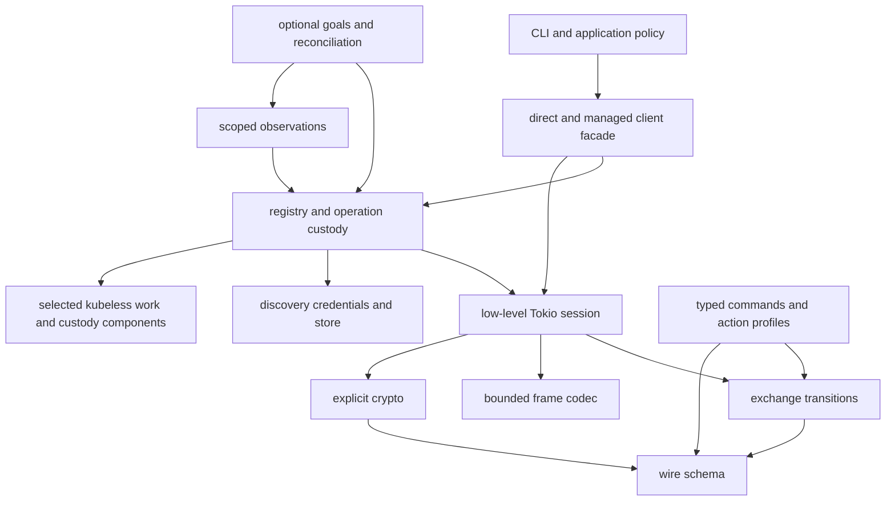

# Registry-first kitty control

## 1. Direction and standing

**The managed API coordinates multiple independent commands concurrently across
bounded connection leases. Accepted operations belong to the registry, not their
individual waiters.** A correct typed exchange engine sits underneath this owner;
it is not the whole public architecture.

The human agreed to this direction after reviewing the research and explicitly
correcting two earlier biases: kubeless is a general control/reconciliation
library, and registry concurrency is the main motivation rather than upload
serialization. This draft incorporates those decisions. Detailed names, type
signatures, resource budgets, and dependency selection remain proposals.

All current local APIs are unstable. There is no consumer compatibility obligation,
including to zooming-kittens. Upstream-version support and existing persisted
key records are separate concerns. This is the next design draft, not a claim
that any proposed implementation or generic framework adaptation already exists.

### Selected direction

- Registry-first concurrent managed execution, with reusable endpoint/setup state.
- One exchange per connection; multiple leased connections per endpoint.
- Accepted work survives dropped waiters. Cancellation is an explicit operation.
- Thin coordination and retained outcomes first, with direct kubeless custody a
  serious candidate; compare the fuller retained host through native journeys.
- Observation primitives are foundational. Continuing desired-state reconciliation
  is a separately usable layer rather than a requirement for every command.
- Concern-specific crates expose useful independent entrances, not just a facade.

## 2. Working vocabulary and ownership

| Term | Meaning |
| --- | --- |
| Endpoint | An address and associated access information; not proven server identity. |
| Registry | Managed endpoint/setup state, bounded admission, connection resources and accepted-operation ownership. |
| Operation | One accepted undertaking with a local ID, bound input, lifecycle and retained outcome. |
| Exchange | The command-specific wire conversation executed on one exclusively owned connection. |
| Lease | Ownership of a connection for an exchange, plus any required admission reservations. |
| Waiter | An observer of an accepted operation's result; dropping it does not cancel the operation. |
| Observation | A scoped acquisition of server/terminal facts, with coverage and timing. |
| Goal | Caller-authored desired condition with a selected policy and lifetime. |

Three execution entrances have distinct lifecycle contracts:

| Entrance | Ownership | Cancellation |
| --- | --- | --- |
| Pure protocol and command crates | Caller owns values and encoding/decoding | No I/O lifecycle |
| Low-level `Session::execute(&mut self, ...)` | Caller owns exchange and transport | Dropping after I/O starts retires the transport |
| Managed `Registry::submit(&self, ...)` | Registry owns work after acceptance | Dropping waiter detaches interest; explicit cancel acts on operation |

The managed registry may have an explicitly owned Tokio driver. Its lifetime is
not tied to any one result waiter. The low-level session needs no resident task.
Neither model is universally imposed on the other.

## 3. Concurrency is the first registry payoff

An ordinary useful workload on one kitty server:

```text
registry endpoint entry
  connection A: launch-and-wait, run, or user selection awaiting completion
  connection B: ls / get-text acquisition or a large finite response
  connection C: independent focus, layout, or mappable action
```

`run` returns buffered stdout/stderr after process exit. Launch can optionally
wait for child exit. Selection waits for a user, screenshots finish asynchronously,
and get-text is a snapshot. These justify independent leases without inventing a
general server event subscription. A connection's reader belongs to its exchange;
responses are never collected into an uncorrelated registry-wide response queue.

Concurrency removes client-side head-of-line blocking and overlaps waits. It does
not promise parallel server CPU execution, atomic groups, or a particular latency.
Measure setup amortization and independent progress rather than assume a pool is
automatically faster.

### Admission and scheduling

Bound accepted work, active exchanges, connections including connections being
established, and retained response/history memory. Track global and per-endpoint
capacity separately. Large results can exhaust memory even when request count is
bounded; retention needs its own budget.

Distinguish short interactive, observation, and long-wait work. Reserve service
opportunity for short work or cap long waits so a pool does not fill entirely with
process-exit waits. Exact defaults are still open. A reasonable initial selector
is round-robin endpoints with bounded, weighted/aging class selection.

Select eligible work before consuming execution slots. Waiting for a pool lease
inside every admitted execution future could consume the whole global budget
without useful I/O. No global registry mutex spans connection establishment,
credential acquisition, producer reads, exchange I/O or result waits.

Independent submissions may overlap. A dependent focus-then-action sequence must
await or explicitly request ordering; cross-connection submission order is not an
effect-order guarantee. Specific UI operations and other profiled conflicts may
share a lane. An endpoint-wide serialization key is an available restrictive
policy, not the default architecture.

### Specialty constraints

Known same-server, same-command uploads share a server accumulator. Admit these
through a specialized exclusion lane while unrelated operations remain eligible.
Known endpoint aliases should share its coordination key. This exclusion only
covers cooperating registry users; it does not control external clients.

A local connection token, a coordination-group ID, PID hints and server identity
evidence have different meanings. Reconnection creates a new local connection
lifetime, not proof of server restart. Initial identity handling can be simple
and explicit; it must not make stronger claims than its evidence.

## 4. Accepted operations and retained results

Illustrative API, uncompiled:

```rust,ignore
let operation = registry.submit(endpoint, command, options).await?;
let id = operation.id();
let result = operation.wait().await?;

// Other callers can submit and wait concurrently through &Registry.
// Detaching this waiter leaves id discoverable in the registry.
```

Prefer explicit submit-and-wait as the foundational managed API. An `execute`
convenience must clearly preserve the same accepted-work semantics. Result lookup
and operation cancellation remain available through the operation ID.

### The acceptance boundary

Acceptance must atomically install the owned input and operation record before
work becomes eligible. Before acceptance, no accepted operation exists. An
ordinary refusal returns the owned command/input when practical.

There is a cancellation race to specify precisely: an asynchronous admission
future can be dropped after the owner accepts but before the caller receives its
handle. That must not create invisible work. Candidate mechanisms are a caller-
known local submission token, or reservation followed by a non-awaiting commit.
Select one through the admission prototype. Do not promise that dropping any
pending submission future proves non-acceptance. A local token is a registry
identity mechanism, not remote deduplication or server exactly-once execution.

### Result custody

Store the native outcome before notifying waiters. Losing a waiter or bounded
notification must not lose the only record of accepted work. Retain unresolved
work through driver replacement while the registry owner survives. This is
in-process ownership, not crash durability.

Retained data needs explicit limits and release semantics. For example, small
operation summaries can remain after a large typed result has been explicitly
taken or released. Do not require every arbitrary output to be `Clone`; decide
whether the typed result has one taker or is shared through immutable ownership.
Full historical retention is not an implicit default.

### Cancellation and shutdown

- Queued cancellation withdraws the exact accepted occurrence before execution.
- Started cancellation stops local driving, retires its transport, and preserves
  what is known about submission and outcome. It does not prove remote rollback.
- Protocol-specific remote cancellation is an explicit best-effort capability.
- Driver loss leaves accepted but unfinished work discoverable. Replacement does
  not automatically replay inputs that were already taken or sent.
- Registry shutdown closes admission, applies an explicit drain/cancel policy,
  and exposes unresolved operations. An empty set of local futures is not proof
  that every remote effect completed or stopped.

## 5. Typed command and exchange core

A command binds payload construction, typed output decoding and a finite exchange
profile. Preserve bon for ergonomic builders where useful. A raw finite-request
entrance supports unmodeled commands while retaining framing and lifecycle rules.

Start with single-response, submission-only, and negotiated-upload profiles.
Deferred completion is an attribute of the reply-bearing exchange; the server's
async ID does not imply an echoed response ID or safe same-socket multiplexing.
Avoid a universal programmable exchange language until actual command contracts
require one.

The outbound path has exactly one protection boundary:

```text
typed payload -> plaintext request -> plain/encrypted envelope -> DCS frame -> bytes
```

Transport code never receives a command object that it can encrypt a second time.
Envelope, crypto and codec types enforce this direction. Each exchange owns a
persistent bounded frame decoder and write progress. Coalesced expected frames
are processed in order; unexplained surplus cannot become the next operation's
response.

Use an absolute budget spanning queue and execution, or separately named admission
and execution budgets when explicitly selected. Never restart a caller-visible
deadline on each chunk/read. Async deadlines are cooperative; bounded synchronous
encoding/decoding must also check budgets rather than claiming hard preemption.

Arm transport invalidation before cancelable I/O begins. Return a connection to
the pool only at a known reusable completion boundary. Initially retire after
submission without acknowledgment, because suppression and error paths can differ.
Retire on interrupted or framing-ambiguous exchanges. Schema decoding failure after
a complete success envelope is distinguishable from an unknown remote outcome,
even if conservative retirement is selected.

### Outcome model

| Outcome evidence | Meaning |
| --- | --- |
| No write started | Failure before entering transport-write execution |
| Write started / outbound complete | Local progress, not proof of remote execution |
| Remote success or failure envelope | Server-native result; an error is not universal proof of no side effects |
| Invalid typed output | Complete reply received but required data cannot be decoded |
| Unresolved | Completion unknown after interruption, loss or timeout |
| Observed satisfaction | A later condition was observed; not proof that an earlier uncertain operation caused it |

Ordinary typed execution can expose the value with an evidence-bearing alternative;
failures retain useful evidence in either case. Registry summaries remain available
independently. Precise public naming is still open; these distinctions are not.

### Command-specific uploads

Support first-frame handshake, input chunks, explicit end marker and terminal
result as a conversation. Empty input may take a different path. Suppressing the
terminal reply does not universally remove handshake reads. Keep target/options
on the appropriate frames, preserve exact bytes and bounded producer demand.
Producer failure after transmission must not silently finalize truncated input.
These requirements belong in audited command profiles, not a generic long-string
splitter.

## 6. Commands include the larger surface inside `action`

RC is a small outer protocol with some large nested entrances:

- `action` dispatches the mappable-action vocabulary, with action-specific argument
  grammar and effects. Known typed action profiles can describe scope and ordering.
- `kitten` can invoke built-in or installed custom capabilities. A no-UI extension
  may provide useful observation, subject to its actual return and installation
  contract; it is not automatically a general structured query API.
- `load-config` interprets a broad configuration schema and can change many
  properties/defaults. Relevant cached interpretations may need invalidation.

Maintain an escape hatch for arbitrary action strings without inferring retry,
completion, or conflict semantics from the outer `Action` type alone. An action
acknowledgment may acknowledge dispatch rather than all later effects.

Typed outputs cover listings, text, launch results, screenshots, and run output.
Missing required data is an error; additive unknown fields remain tolerated where
the schema permits growth. Use upstream-derived fixtures, not local serializer
round trips as the only oracle.

## 7. Discovery, credentials and setup remain separate

The registry composes these stages rather than hiding them inside transport:

1. Capture selected configuration/environment inputs.
2. Enumerate endpoint candidates with origins; explicit endpoints bypass this.
3. Select or register endpoint bindings and any known aliases.
4. Resolve requested authentication policy and password source.
5. Resolve a server public key for the selected endpoint and preserve provenance.
6. Validate/prepare crypto inputs.
7. Reserve connection capacity and establish a transport under budget.
8. Install it only if the relevant endpoint/credential generation still applies.
9. Run any explicitly requested probe with command-scoped interpretation.

Discovery enumeration and credential acquisition involve I/O; their parsing and
selection cores can be pure. Crypto neither reads ambient environment nor invokes
`kitty-pubkey-db`. Key-store library and CLI share one parser/storage boundary.
Existing persisted records need a deliberate format/import decision; unstable
Rust interfaces do not authorize silently discarding data.

Reuse resolved setup while its selected policy permits it. Credential changes
invalidate relevant pending preparation and cached authorization evidence, not
historical outcomes. An `ls` probe cannot establish permission for every action.

## 8. Concern-crate workspace

Prefer the control-domain grouping below. Crate names remain provisional; each
leaf has its own responsibility and can be used without the top-level facade.

| Domain / crate | Responsibility |
| --- | --- |
| `protocol/schema` | Wire request/response types and version vocabulary |
| `protocol/frame` | Incremental DCS framing, exact boundaries and limits |
| `protocol/commands` | Typed RC commands, nested action profiles and output models |
| `execution/exchange` | Runtime-independent exchange decisions and outcome evidence |
| `execution/tokio` | Socket ownership, read/write driving, budgets and cancellation guard |
| `access/endpoint` | Native address types, endpoint references and provenance |
| `access/crypto` | Explicit one-envelope protection and key parsing |
| `access/discovery` | Candidate acquisition and selection helpers |
| `access/credentials` | Credential-source policy, resolution and binding |
| `access/key-store` | Shared persisted key-record I/O and format |
| `control/registry` | Admission, concurrent leases, setup reuse and operation custody |
| `observation/listing` | Scoped snapshot acquisitions and sampled changes |
| `control/goals` | Optional authored goals, check-only follow-up and selected reconciliation |
| `client` | Ergonomic direct/managed facades and re-exports |
| `apps/cli` | Configuration precedence, command UX, output and key-store utility |

Optional terminal observations can have their own channel/observation crate when
commissioned; their I/O ownership differs from RC sockets. An alternative coherent
layout groups `client/{direct,managed}`, `capability/{commands,observations}`,
`channel/{rc,terminal}`, and `setup/{endpoint,credentials,store}`. Prefer the first
for explicit domain ownership; no directory move is performed by this draft.



This is a responsibility graph, not permission for crate cycles: registry owns
execution and result custody; observation adapters depend on its public execution
entrance, while the registry stores generic/native observation values only if
needed. A shared observation vocabulary must be a lower leaf, not a registry-to-
listing back edge. Generic kubeless crates never import kitty.

## 9. Kubeless: a constructive integration decision

The initial no-dependency conclusion was appropriate only for a narrow wire
executor. The adaptation research identifies real generic machinery and native
consumer tests for the managed architecture.

**Initial preference:** native registry coordination over a small selection of
generic work/custody components. Compare that with `control-retained-actions`
before deciding the fuller host buys enough to justify its metadata/composition.
This is a dependency candidate and experiment, not a settled dependency manifest.

| Candidate | Useful role | What remains native |
| --- | --- | --- |
| ReadyWork / Executor | Retained ready work and bounded active futures | Fair endpoint/class selection, connection quotas and specialty claims |
| Custody / returns | Accepted one-shot inputs, original outputs, unresolved work and intake before notification | Typed command/result mapping, resource retirement, retention policy |
| Retained-actions host | Driver replacement and explicit effect/check policy with native basis revalidation | Endpoint registry, command semantics and pool scheduling |
| Checks / observation leaves | Scope facts, assess conditions, check-only continuations | Acquisition, target correspondence, coverage and freshness evidence |
| Descriptors | Typed capability identity/facts | Routing, authorization and nested action contracts |

The most useful proposed kubeless adaptation is a **custom fair work-lane entrance
into its retained host**, so native eligible work is selected without rebuilding
result custody or occupying execution slots with pool waiters. Begin with native
quota/conflict admission; extract generic claim-set reservations only when a
second consumer establishes their reusable contract. Current equality-keyed
exclusion is not an arbitrary overlapping-resource lock system.

Three discriminating journeys should decide the integration:

1. Concurrent long wait, large text acquisition and short action, including
   endpoint saturation, admission cancellation and deadlines.
2. Launch with lost reply/waiter/driver, followed by an explicit listing check,
   preserving original uncertainty without relaunching.
3. New desired generation arriving while an older result or observation is pending,
   without older accounting overwriting the new goal.

Compare native glue, direct custody and retained host against those journeys.
Measure complexity in ownership guarantees and duplicate bookkeeping, not just
crate count. Keep framework improvements in kubeless and kitty protocol details
here. Pin an actually fetchable reviewed dependency revision if selected.

## 10. Observation and optional reconciliation

An observation reports subject, route, acquisition interval, coverage, knowledge
and interpretation basis. Failed acquisition is not an empty listing. A later
arriving response is not necessarily a fresher sample. Polling produces sampled
state, not a lossless watch or invented resume cursor.

The RC catalog offers listings and snapshots; other routes can add observations.
For example, XTGETTCAP can report current font size in its terminal context, and
a verified custom no-UI kitten may offer a deployed RC observation extension.
Capabilities depend on actual access and target binding; the base client should
not silently acquire someone else's terminal I/O.

Selected higher-level policies can include apply-once, observe-until, maintain-
while and yield-on-divergence. Observing satisfaction does not retrospectively
prove a lost reply's mutation executed. A check-only continuation contains fresh
observation input, not retained mutation input hidden behind a retry timer.

CAS-free convergence can be useful under stable targets, usable observations and
explicit competing-writer policy. It cannot provide atomic conditional updates or
exactly-once launch. An increment-once is not equivalent to an absolute maintained
goal; converting between them changes intent and requires caller choice.

This layer can share registry scheduling and custody without forcing desired-state
maintenance on ordinary `ls`, launch or action calls.

## 11. Upstream support and verification

Research pins the old target to kitty 0.43.1, latest stable to 0.49.2 and inspected
HEAD to unreleased 0.50 development. Core framing/encryption remained stable while
command schemas and server behavior evolved. Select a tested minimum explicitly;
do not raise every wire version simply because the newest server is newer.

Acceptance evidence for an implementation should include:

- Source-backed command and nested-action wire fixtures, typed success/error
  decoding, and independent encryption checks.
- Scripted fragmented/coalesced frames, writes and failures, operation-wide
  deadlines, no-response variants, and cancellation at each exchange phase.
- Registry admission races, bounded memory/work, no locks over I/O, long-wait
  isolation, fairness and exact lease retirement/return.
- Accepted results surviving waiter loss; unfinished operations surviving driver
  replacement without blind replay; explicit retention and shutdown behavior.
- Empty/small/large uploads, handshake/end semantics and specialized exclusions.
- Scoped sampled observations, failed/partial acquisition, stale generations and
  explicit unknown-effect follow-up.
- Real isolated kitty instances for chosen supported versions, including multiple
  simultaneous connections, long waits and sequential reuse.

Existing targeted kubeless tests establish some generic mechanism properties;
they do not establish the proposed integration. The earlier 159-test kitty result
described an older source snapshot. This draft adds no new source-test claim.

## 12. Coherent landing proposal and remaining choices

If implementation is commissioned, the first vertical slice should include the
managed registry rather than defer it: pure schema/frame/command boundaries,
correct typed session, explicit setup inputs, bounded concurrent leases, accepted
operation IDs, retained outcomes, and the three-connection isolation fixture.

Then develop setup/discovery/store composition, command catalog corrections and
nested actions, upload profiles, CLI use, and observation/control integration in
coherent slices. The custody/retained-host comparison can start with scripted
transports before the full catalog exists. Preserve the old API only as historical
evidence, not as a compatibility facade requirement.

Still open for concrete design or prototyping:

1. Admission commit mechanism and discoverability across canceled submission.
2. Exact custody component versus full retained host and custom work-lane seam.
3. Capacity/fairness defaults and retained-output ownership/release semantics.
4. Public raw/typed extension boundary beyond finite requests.
5. Rust minimum and kitty support matrix, including stable versus provisional HEAD features.
6. First actual observation/reconciliation workflow after concurrent execution.

## Cross-references and synthesis boundaries

- [Research map](README.md) maintains current navigation and decision standing.
- [Initial draft](draft0.gpt6a.md) preserves the simpler exchange-first argument;
  this draft revises registry timing and ownership rather than erasing that evidence.
- [Kubeless adaptation](kubeless-adaptation1.gpt6a.md) supplies the strongest
  constructive managed-control design. Its richer reconciliation architecture is
  a selectable future layer, not wholly adopted here.
- [Kubeless exchange study](kubeless-design0.gpt6a.md) remains the detailed basis
  for the lower exchange engine despite its earlier over-narrow dependency verdict.
- [Tmax comparison](tmax-lifecycle0.glm53m.md) supports typed preparation and honest
  outcomes. Its protocol-specific machinery and initial registry deferral do not
  set this managed architecture.
- [Upstream evolution](../upstream-kitty/evolution0.gpt6a.md) governs historical
  baseline and source-pinned protocol changes, distinct from local API redesign.
