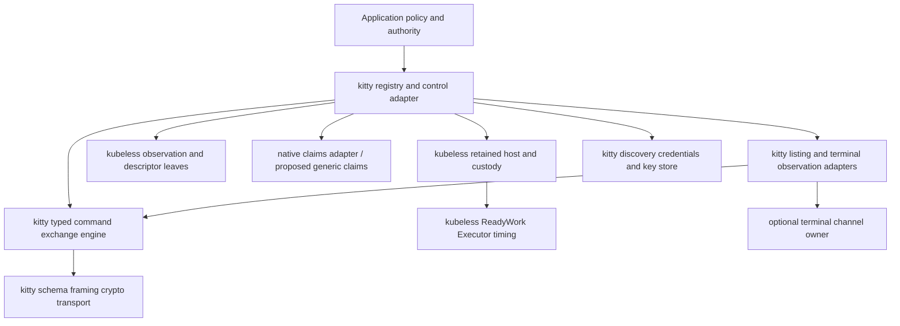

# Registry-owned control, with kitty as a demanding consumer

## 1. Revised recommendation and why it changed

**Make a bounded concurrent-command registry part of the initial managed kitty interface, and
evaluate kubeless's retained control host as its execution/decision substrate.**
Keep the correct single-owner exchange engine underneath it. These are different
levels of ownership, not competing choices between a tiny client and a giant
framework.

Its primary payoff is **multiple independent commands progressing on multiple
connections**, reusable endpoint/credential setup, head-of-line isolation, fair
bounded admission, and endpoint fanout. One outstanding exchange **per connection**
does not mean one outstanding operation per client or endpoint. A registry is
useful before persistent desired-state reconciliation is selected.

The human challenged the predecessor's negative recommendation:

> “it's explicitly not about kubernetes. http is also somewhat incidental. we're
> trying to make a control/reconciliation library … it feels like we need to be
> more registry based from the start given kitty proto restrictions”

That challenge is warranted. I asked mainly whether existing components could
replace pieces of a preselected finite exchange executor. The more useful question
is **which continuing responsibilities a kitty controller should own, and which
of those kubeless already models or could usefully generalize**. The human has
now explicitly commissioned reconciliation design; earlier avoidance of
unsolicited reconciliation is not a veto on this work.

Subsequent human steering further clarified that uploads are a supported special
case, not the registry's main motivation: the aim is to run multiple commands
without waiting for each preceding one. The human also confirmed the nested
`action` surface. This revision centers concurrency and treats RC commands as
entrances to capabilities, including nested actions and extensions, rather than
assuming the outer command catalog exhausts them.

The deeper review finds substantial existing machinery, not merely suggestive
names: retained one-shot inputs, latest versus bound duties, original result
custody, check-only continuations after uncertainty, stale-decision refusal,
driver replacement, and retained absolute scheduling floors. Kubeless already
has foreign native consumers exercising several of the exact journeys needed.

### What changes from the predecessor

| Earlier position | Revised position |
|---|---|
| Start with `Session<&mut connection>` and add a registry only later. | Keep that exchange primitive under a concurrent `&self` registry interface from the first coherent architecture. Independent commands lease different connections; some resource conflicts are broader than a connection. |
| No initial kubeless dependency; most generic control machinery is unnecessary. | Reasonable for the standalone wire client, too strong for the commissioned control library. `work/custody`, `control/retained-actions`, observation facts and scheduling are serious dependency candidates. |
| Absence of kitty CAS rules out conditional-operation machinery. | It rules out a **conditional-write guarantee**, not read/decide/unconditional-write composition, best-effort convergence, or observing a goal. Even `operation` documents an unconditional family with no conflict class. |
| Settlement is a possible later add-on. | Native outcome, later observations, and continuing desired state are central registry concerns; they must be distinct from the start even if individual callers request only a native result. |
| Font operations have poor readback possibilities. | Observation is channel-specific. Parent-verified XTGETTCAP reports current font size; RC-only access and target-terminal access have different capabilities. |

What remains true: replies are not generally correlated by async ID; one exchange
owns each RC connection; command-specific uploads need real handshakes/end markers;
local cancellation does not undo effects; raw response retries and HTTP status
rules are inappropriate. The [predecessor](kubeless-design0.gpt6a.md) remains useful
as the lower-layer design, not the complete control architecture.

This is a proposal for synthesis, not acceptance or authorization to implement.

## 2. Grounding in kubeless's actual general-purpose mechanisms

The follow-on read used `~/src/kubeless` → `~/src/kube-kubeless` at jj
`7523451ec3eea927515b81c3d2b2c79957dcb64b`, parent
`9e7a1298d69f5aa4bb80bb0ac0d9f943f6df6df2`. The working-copy diff was empty.
This is a later snapshot than the predecessor's `ee984da4…`; no assumption of
Git HEAD equivalence is made. Repository URLs below pin source coordinates;
publication of these local jj commits has not been checked.

The [native capability guide][k-guide] explicitly describes a family of stopping
points, not a disabled Kubernetes runtime. Source inspection supports that claim.

| Existing mechanism, with inspected source | Useful kitty/control responsibility | What it does not supply |
|---|---|---|
| `work/ready::ReadyWork`, `ConsumerWake` | Retain pending work until a consumer accepts it; carry a reservation permit; register before inspecting and retain work independently of wakes. | Fairness, multiple consumers, resource identity, or a lock manager. |
| `work/admission::CheckedAdmission` | Explicit accepted ownership versus ordinary rejected input, useful for bounded registry ingress. | A result vocabulary, not a queue or admission algorithm. Its Closed variant carries caller-chosen closure evidence; include the input there if ownership must be returned. |
| `work/execute::Executor` | Bounded future concurrency and one active future per projected native key. | Intersecting resource sets; physical remote-job termination; fairness. Dropped futures leave past effects real. |
| `work/merge::merge_with` | Explicit combine/separate/supersede decisions retaining ordinary refused inputs. Coalesce a latest absolute zoom request without accidentally combining launch commands. | Domain authority to discard an increment or fixed input; merging by equal key is not enough. |
| `work/custody::Owner<S>` | Latest desired levels and bound one-shot duties, non-Clone inputs taken once, exact run outputs and partial returns, retained unresolved work after driver loss. | Backend success judgment, socket ownership, remote cancellation, process durability. |
| `control/retained-actions::host` | One surviving native owner, replaceable polling attachments, return intake before advisory output, discovery of old results/unfinished runs, independent policy work and exact accounting. | Endpoint registry schema, capability routes, native effect policy; its default executor has one equality-based exclusion key. |
| `control/returns::{finish,map}` | Transfer actual returned output into the surviving owner in the same poll before any advisory callback/await. | Storage by itself. A continuation that discards its value still loses it. |
| `control/checks` | Assess all original asks against one acquired basis; retain native outcome and checks separately; check-only follow-up cannot secretly carry old mutation input. | Query planning, freshness/correlation truth, generic success criteria. Unbounded waits retain unbounded evidence unless constrained. |
| `control/resolution` and `control/pass` | Resolve current or validate bound context when work becomes eligible, preserve evidence separately from invocation input. | A local validation is not a fence against later external change. |
| `observation/model::{SubjectRef,Evidence,Observed}` | Scope terminal/window facts; distinguish Unsupported, Missing, Known(None), and Known(value). | Ordering or authority. Acquisition errors are separate from fact knowledge. |
| `observation/assessment` | Compare projected observations with caller-owned baselines or authored Open/Exact collections without silently accepting a new baseline. | Desired-state ownership or authority to apply a computed difference. |
| `view/memory`, `observation/reflection`, `observation/reflector` | Coherent local listing state, staged snapshot installation, readiness and cancellation-safe retained publication. | Server-atomic snapshots, wire watch cursors, lossless external events, distributed CAS. |
| `control/requeue`, `work/schedule`, retained-host `timed` | Revisit an observation/goal under an explicit policy; persist a not-before floor through attachment replacement. | Permission to repeat a write. Default schedule payload selection is deadline-based, not necessarily latest desired value. |
| `catalog/descriptor::Descriptor<I,F>` | Native capability identity/facts for effects and observations over different channels. Static and runtime descriptions have a shared lending interface. | Routing, acquisition, authorization or endpoint lifetime. |
| `catalog::Catalog` | Snapshot lookup and declared-versus-discovered capability comparison if a string-oriented capability index is useful. | A live endpoint/operation registry. Its freshness flag is provider-reported, not an expiry clock. |

### Strongest concrete precedent: unknown result → check-only continuation

Read [the foreign continuation implementation][k-continuation] and
[its tests][k-continuation-tests]. It uses a native mapping store, not HTTP:

1. A write has a real effect but returns `Output::Unknown`.
2. Its native output is retained before advisory delivery; losing the delivery and
   old driver does not lose the record.
3. Follow-up input is `Call::Read { reader, slot }`, which contains **no old write
   input**. A failed check schedules another check, not a mutation replay.
4. A retained deadline survives another driver replacement.
5. Later observation does not rewrite the original Unknown into acknowledgment.
6. New desired work and cleanup are separately admitted and decided; an external
   ownership change does not authorize the old cleanup.

This is directly relevant to an uncertain kitty operation followed by `ls` or a
terminal query. The probe's cleanup uses a checked local backend; that stronger
conditional cleanup property must not be credited to kitty. The ownership and
continuation composition itself is valuable without it.

Also read the [maintained host tests][k-host-tests]: stale asynchronous policy
decisions revalidate their captured native basis; a dropped native acceptance
remains an exact named unresolved occurrence; lost outputs are not remutated.
These are precisely the registry behaviors my earlier recommendation overlooked.

## 3. Concurrent registry first: connection leases, independent work, fair admission

### A concrete useful workload

One endpoint can have:

* Connection A awaiting `launch` with `wait_for_child_to_exit`, a `run` process,
  or a user selection.
* Connection B performing `ls` or get-text acquisitions for a UI/observer.
* Connection C handling an independent focus or mappable action request.

The parent verified at pinned kitty HEAD that `run` returns buffered stdout/stderr
on process death; launch may await child exit but ordinarily returns a window ID;
select-window waits for a selection; screenshot completes asynchronously with
PNG/path data; get-text is a finite snapshot. These are concrete reasons for
connections remaining leased during long waits or large response reads. They are
not evidence of a general unsolicited live RC subscription stream. In-process
Python watcher callbacks need a separate bridge before they become library input.

Each reader remains attached to the connection carrying its own exchange. There
is no single registry-wide response reader and no uncorrelated reply fan-in. More
than one connection can be reading a finite response or awaiting async completion
at once. An observation class may reserve pool capacity or a dedicated lease, but
it is repeatedly issuing queries rather than subscribing to an invented RC event
channel. Concurrent upload connections are also possible subject to their narrower
command/server conflicts; “streaming connection” should name the actual conversation.

The registry can keep B and C progressing while A is waiting. It cannot promise
parallel server CPU execution, immediate focus response from a busy server, or
safe simultaneous UI interactions such as several select-window prompts. A
capability profile can put those UI operations in a shared exclusive lane while
leaving ordinary reads independent.

### Public concurrency and ownership

Proposed uncompiled shape:

```rust,ignore
impl Registry {
    // Many callers may await this concurrently; no global mutable borrow across I/O.
    async fn execute<C: Command>(
        &self, endpoint: EndpointRef, command: C, options: RunOptions,
    ) -> Result<Receipt<C::Output>, ExecuteError>;

    // Admission is explicit; the operation remains registry-owned after acceptance.
    async fn submit<C: Command>(
        &self, endpoint: EndpointRef, command: C, options: RunOptions,
    ) -> Result<Operation<C::Output>, AdmissionError<C>>;
}
```

Choose and document the two cancellation cuts: dropping an admission future before
acceptance leaves no accepted operation; after acceptance, dropping a result waiter
does not silently revoke registry-owned work. Explicit `Operation::cancel` requests
withdrawal if queued or local cancellation/uncertain-result recording if started.
A separate borrowed low-level Session may retain cancel-on-future-drop semantics.
The facade must not blur these contracts just because both methods are async.

A spawned shared registry profile needs owned, appropriately `Send + 'static`
queued inputs/results; a scoped/local drive entrance can retain kubeless's borrowed
and non-Send capabilities. Those are honest distinct host profiles. The sketch
omits the eventual bounds rather than promising every borrowed command can be
detached into a persistent task.

Registry metadata changes happen in short owner turns. Connection creation and
credential acquisition occur outside locks, then install only if the captured
binding/setup generation remains applicable. Connections move into exclusive
exchange leases; **no registry mutex is held over connect, source reads, socket
writes, terminal queries, or response waits**. Successful reusable sessions return
to the pool under the same exact lease generation; interrupted sessions retire.

### Bounded scheduling, not universal endpoint serialization

Track separately:

1. Global accepted-work and in-flight budgets.
2. Per-endpoint queued work and active connection limits, including connecting
   sockets so a burst cannot oversubscribe the limit.
3. Class policy: short interactive operations, observation acquisitions, and
   potentially long-running commands. Reserve some service capacity or cap the
   long-running class; otherwise a bounded pool can still be entirely occupied
   by long waits.
4. Native exclusion/ordering keys: selected UI scope, shared upload accumulator,
   deliberate ordered sequence, or a particular property under local policy.

Use round-robin eligible endpoint selection plus weighted/aging class selection
as a concrete initial fairness policy. Bound scans and ingress per polling turn;
give completed operations/returns priority sufficient to release leases. This
policy belongs in a native `ReadyWork` producer, not `HashMap` iteration order.
Kubeless's Executor explicitly promises no fairness, and its admission loop can
consume repeatedly ready work; a bounded producer should yield/wake after a turn
budget. Its `Capacity` supplies global active-future bounds, not endpoint quotas
or byte-memory limits. Bounded frame/output sizes remain necessary underneath.

An accepted request has one deadline policy covering queueing and execution, or
explicitly distinct admission/operation deadlines. Do not let a request become
arbitrarily old in the queue and then restart its caller-visible budget when a
connection becomes available. Retained scheduling floors are not timeout budgets.

Use `work-keyed` keys for actual independent occurrences or explicitly chosen
conflict lanes, not universally `endpoint_id`. A distinct connection/operation
key lets independent exchanges coexist; per-endpoint quota and specialty conflict
checks live in admission. List fanout across endpoints is similarly bounded and
fair. Pooling improves opportunity for progress and amortizes setup, but its
latency benefit needs measurement rather than being inferred from reuse alone.

### Ordering is selected, not inferred from concurrent submission

Two `&self` calls are independent unless the caller awaits the first or submits
an explicit ordered group. A focus-then-action sequence needs that relationship;
running it on different connections can reorder its effects. “Latest desired
font level” can intentionally supersede unsent older levels; two increments or
two launches cannot be coalesced that way by generic policy. Active-target commands
remain sensitive to external focus changes even inside a locally ordered lane.
Multiplexing means independent **connections**, not an async-ID pending map on one
connection whose replies do not carry those IDs.

### Ownership of responsibilities, not just pooled sockets

Use **one managed registry owner** for cooperating users across server groups. A
connection is a replaceable resource borrowed by work. A desired state, uncertain
operation, credential binding, or upload lane can outlive any connection.

Separate three meanings often hidden in “registry”:

1. **Endpoint/subject registry:** aliases, identity evidence, scoped windows and
   channels, observations and access paths.
2. **Capability registry:** which native effect/observation routes can be selected
   for a particular subject, with evidence and access prerequisites.
3. **Responsibility owner:** accepted goals/one-shots, prepared inputs, native
   returns, decisions and unresolved obligations. With kubeless, use custody as
   this owner, rather than adding a second mutable per-operation status map.

An illustrative native state is:

```rust,ignore
struct KittyRegistryState {
    endpoints: EndpointDirectory,
    routes: CapabilityBindings,
    observations: ObservedState,
    policy: PolicyState,
    resources: ResourceClaims,
    connections: ConnectionResources,
    duties: kubeless_work_custody::Owner<KittyWork>,
}
```

This is an uncompiled sketch. Fields describe distinct authorities, not necessarily
distinct allocated maps: derive operation status from custody and active handles;
derive readiness from route/credential/observation facts. Do not create `healthy`,
`connected`, `controllable` booleans that drift independently. One successful `ls`
does not prove permission for every mutation.

### Identity and generations must stay independent

| Coordinate | What it means | What it must not be mistaken for |
|---|---|---|
| `CoordinationGroupId` | Local decision to serialize aliases that may address the same server. Can be deliberately conservative. | Verified server incarnation. |
| `EndpointAddress` plus provenance | Unix path/abstract address/TCP route or terminal access route and its source. | Unique process; canonicalizing a path is insufficient identity evidence. |
| `ServerIdentityEvidence` | Available PID/start information, key fingerprint, probe facts, or explicit caller binding, with scope. | Universal proof of identity from PID, key equality, or one connection token. |
| `BindingGeneration` | Local change in endpoint/subject association or route selection. | A kitty server revision. |
| `CredentialGeneration` | Change in selected credentials/key provenance and locally known authorization facts. | Proof that every server command has revoked/accepted them. |
| `DesiredGeneration` | New authorized level of intent for a duty; supersession policy selects what may replace what. | Evidence of an effect or observation. |
| `ObservationGeneration`/acquisition interval | Local acquisition/installation order and its coverage, start/end times, channel and interpretation basis. | Source order across simultaneous reads, a wire cursor, or durable checkpoint. |
| `ConnectionToken` | Local socket ownership and framing lifetime. | Server incarnation or permission to repeat a command. |

`observation-model` and `view-memory::Anchor` already help keep these distinctions
honest. A local anchored commit can prevent an old computed registry update from
overwriting newer local state; it cannot prevent a user changing kitty between
observation and write.

**Aliases affect correctness:** uploading through two aliases must acquire the
same server-command lane when the registry knows they share a coordination group.
Do not silently merge two active groups and announce mutual exclusion after the
fact. Freeze affected admissions, retain old claims, finish or classify their
work, then install the new grouping. An explicit user-supplied broad group can
serialize uncertain aliases at the cost of concurrency. Unknown aliases and
external clients remain outside the guarantee.

Changing credentials invalidates pending preparation and relevant authorization
evidence; it does not erase in-flight receipts or create a fresh upload lane on
what may be the same server. Suspected restart likewise invalidates subject
bindings/readiness but preserves old unresolved operations under their old basis.

## 4. Native admission and a useful framework adaptation

Kitty requires at least these independently scoped resources:

* `RcConnection(connection_token)`: one complete exchange, because arbitrary
  concurrent replies cannot be correlated.
* `Upload(coordination_group, command_name)`: one upload for that command across
  connections, because the inspected command singleton has one accumulator.
* `TerminalIo(terminal_binding)`: exclusive query conversation for XTGETTCAP;
  unrelated application reads can otherwise consume the reply.
* Optional native **intent conflict scopes**, e.g. focus-dependent work for a
  server, or absolute writes to a particular property/subject among cooperating
  controllers. These are policy, not additional kitty protocol locks.

A tuple `(server, command, connection)` as one executor key is **wrong** for shared exclusions: different
connections make unequal keys even when they share the upload accumulator.
Similarly, two uploads to different commands on one connection still collide on
that connection. Conflict is set intersection, not equality of a composite tuple.

### Existing viable route without a new framework crate

A native `ReadyWork` producer can select an eligible endpoint/class under quotas,
choose an idle connection or reserve a connecting slot, and transfer one prepared
work item. `Executor` tracks distinct admitted occurrences and provides its global
capacity bound; native state tracks endpoint pool reservations and specialized
conflicts. This supports bounded concurrent exchanges from the beginning without
changing generic scheduling machinery. For the retained host, eligibility can
derive endpoint/class occupancy from accepted runs carrying immutable route/class
descriptions, so each newly accepted run counts before its future starts.

Per-endpoint capacity one remains a selectable compatibility/resource policy, not
the recommended universal exclusion key. It does not meet the human's central
head-of-line-isolation objective when selected globally.

The current retained host also lets native `State::eligible(&Claim)` inspect all
retained run/resource facts under the owner turn. For claims fully represented
in retained runs, eligibility can derive conflicts from those records rather
than a parallel lease map. This may suffice before extracting a generalized
resource mechanism. It requires careful handling of already-accepted untaken
input so its own reservation does not block its resumption.

### Constructive extension: retained conflict claims

Candidate `kubeless-work-claims` (new, proposed) would own a small pure
reservation law for quotas and native exclusions, not a scheduler or endpoint
registry. A first native adapter may compose existing endpoint counters with
exclusive claims; extracting them together is justified only if that all-or-none
reservation boundary is actually shared by consumers:

```rust,ignore
struct ClaimSet<K, Q> {
    exclusive: Vec<K>,
    capacity: Vec<(Q, usize)>, // e.g. one endpoint slot and one long-wait slot
}
struct ReservationId { owner: OwnerId, sequence: u64 }
enum ClaimDisposition<E> {
    Released(E),
    HeldForUnresolvedEffect(E),
    Transferred { successor: ReservationId, evidence: E },
}

// Native owner performs one short turn: inspect all claims, reserve all or none.
fn reserve<K, Q, W>(work: W, claims: ClaimSet<K, Q>)
    -> Result<Reserved<W>, Refused<W>>;
```

Begin with exclusive sets plus explicit finite quota consumption where needed;
do not infer hierarchy from key structure. Reader/writer modes need a concrete
consumer before addition. Returned refusals preserve non-Clone input. Reservation
identity is unreused and exact, so an old completion cannot release a successor's
claims. The owner outlives driver futures; dropping a future is **not** automatic
release of a claim about remote effects.

The existing `ReadyWork` permit law is a good seam. But the current
`work-execute::Executor` uses its permit as a single equality key and starts with
only `Work`; the retained host's `State::eligible` is an immutable predicate and
`WorkLane` performs claim transfer internally. Do not pretend arbitrary retained
multi-resource reservation is already a drop-in feature.

Two credible adaptations:

1. **Native ReadyWork adapter first:** use one native outer state to validate
   resources, perform existing custody admission, and bind resource claims to
   that exact accepted run in the same synchronous turn. An invariant failure
   cannot partially reserve unrelated resources. Reuse the existing executor for
   capacity and actual futures. Expose this adapter as a retained-host entrance
   rather than implementing another custody/dispatch engine.
2. **Generalize executor admission:** parameterize resource admission/permit
   handling separately from a run's completion key, with exact permits carried
   into start/return. Keep `Executor::new`'s simple keyed profile. Retained-host
   composition binds those permits into native ownership, including resumption of
   untaken accepted work. Validate this against a second consumer such as a
   controller sharing device buses and per-device operation lanes.

The first avoids generalizing before the semantics are proven; the second gives
kubeless a broadly useful coordination capability. Both require tests for atomic
claim-set admission, drop-before-take, resumed claims, and stale release.

### Cancellation and uncertain lane occupancy

Separate **local physical resources** from **uncertain logical responsibility**.
An interrupted RC socket is retired immediately. A taken operation remains
unresolved in custody. For an interrupted upload, whether to start a replacement
is an explicit native policy: a fresh stream ID resets the inspected accumulator,
but old queued server input/external writers mean this is not a transactional
abort guarantee. Policies can hold the lane, explicitly supersede with a new
desired image, or require revalidation. A freed future slot alone decides none
of these.

Keep upload reservation through the declared upload/terminal boundary initially;
later release after a proven earlier boundary is an optimization needing evidence.
Async `run` execution may continue long after input accumulation ends, so its
upload-lane lifetime and its process-result obligation are distinct even if the
first implementation conservatively holds both until completion.

## 5. Three plausible architectures and concrete workflows

These are selectable products, not compulsory phases through increasing complexity.

### Capability descriptions include nested RC surfaces

The human confirmed `action` as the larger surface inside RC. Direct source reads
of `rc/action.py`, `rc/kitten.py`, and `rc/load_config.py` establish three useful
extension points:

| Outer RC entrance | Nested capability | Registry/control consequence |
|---|---|---|
| `action` | An action string with action-specific argument parsing; `response_from_kitty` selects a window and calls `boss.combine(..., raise_error=True)`. | The catalog needs optional typed mappable-action profiles, not just an `Action -> ()` envelope. Scope, duration, ordering and outcome semantics depend on the nested action. |
| `kitten` | Built-in or custom kitten name/path plus list-valued arguments; the inspected handler runs on the first selected matching window and returns a result only when it is a string or boolean. | A custom `no_ui` kitten is a plausible RC-side observation/effect adapter, subject to an explicit installed-extension contract. It is not automatically a generic structured query API. |
| `load-config` | Config paths and list-valued overrides interpreted by the server's configuration schema. | Can affect many properties and future defaults; model it as a configuration capability whose completion can invalidate relevant cached capability/interpretation facts. Do not equate it to an isolated property setter. |

Keep a layered identity such as `RcAction(KnownActionProfile)` or
`RcKitten(ExtensionId, ContractVersion)` beside ordinary command profiles.
`catalog-descriptor::Descriptor<I,F>` supports native identity/facts without
forcing every nested action into a string catalog entry. Reuse native typed
preparation and `control-action-library` contributions if groups serve several
asks; assembling an action group does not establish cross-action atomicity.

Known nested profiles can declare meaningful scheduling conflicts and observational
follow-ups. Arbitrary action strings remain executable through a raw capability
with explicit caller ordering and no inferred replay/settlement semantics. A typed
outer envelope does not make every mappable action a known-effect operation or
make an ordinary reply prove completion of whatever work it started. Repair the
existing local `send_key` versus `action` payload defect as part of implementation,
not by treating the old serializer as a schema oracle.

A custom no-UI kitten could report a target-bound font/state observation through
an ordinary RC reply, avoiding a required terminal channel for that deployment.
Before advertising that capability, verify installed code identity, result
encoding and parsing, which window is selected, authorization, exceptions,
whether it is truly synchronous/no-UI, and what its return establishes. Preserve
those facts in the capability binding. This remains an adaptation option, not a
claim that a stock RC socket already exposes arbitrary font queries.

### A. Thin endpoint coordination registry

**Owns:** endpoint groups, route/credential versions, connection resources,
bounded admission, upload lanes, retained native outcomes and unfinished work.
Accepts one-shot commands and observations; does not keep a permanent desired
state controller running by default.

**Kubeless use:** `ReadyWork`/`Executor`, optionally direct `work-custody` for
retained ownership and `control-returns` for the return boundary. `work-merge`
can share identical read requests under native compatibility rules. A compact
native implementation remains a fair comparator; do not use the entire retained
plan framework just to expose three one-shot calls.

**Kitty workflows:**

* Font/focus/action: accept an explicitly scoped absolute font operation, focus
  command or profiled nested action,
  validate its binding when eligible, report native acknowledgment and uncertainty.
  A TTY font observation is a separate operation using the registered terminal
  route. No restoration loop is implied.
* Images: callers using aliases join one upload lane; the existing exchange
  driver performs command-specific transfer. Large uploads on one server do not
  block another server.
* Launch: retain one bound input and operation ID. A caller dropping its wait
  handle does not cause another launch. Inspect an uncertain result later.
* Listing/watch: keep finite reads progressing on their own connection leases
  while a launch-wait occupies another; coalesce compatible concurrent `ls` requests and optionally
  schedule refresh requests. Publish **sampled** snapshots; missing polls are not
  represented as a lossless watch history.

**Lifetimes:** registry resources survive individual request waiters. The caller
may explicitly poll `drive_until_idle`, or own a `RegistryDriver` task. Dropping
only a waiter detaches interest; cancellation of accepted work is a separate
request. Dropping the driver stops local futures and leaves enumerable duties.
Dropping the last registry owner loses volatile state. Those meanings are public.

**Cost/fit:** simplest answer to concurrent execution, reusable setup and shared
coordination needs. It does
not need desired-state machinery, but retained outcome design prevents a later
host from being built on ambiguous unit-returning send calls. Start with bounded
multi-connection admission and fair native scheduling; specialty claim-set machinery
can remain a small adapter until its reuse is demonstrated.

### B. Generic control host with typed effect and observation capabilities

**Owns:** the same registry plus bounded/latest duties, original native results,
read/check continuations, policy basis, and explicit accounting. The registry
is a kitty-native `host::State<KittyWork>` over `control-retained-actions`.
Native effects and observations are ordinary work; policy computation does not
hide an effect inside a later awaited “decision.”

This is the strongest present kubeless fit. No HTTP or Kubernetes adapter is on
the required path. The [continuation probe][k-continuation] is a usable composition
precedent, not a speculative design from scratch.

**Typed capabilities:** keep a closed native sum initially:

```rust,ignore
enum KittyWork {
    Effect(PreparedKittyEffect),
    Observe(PreparedObservation),
}
enum ObservationRoute {
    RemoteControlListing { binding: RcBinding },
    RemoteControlExtension { binding: VerifiedExtensionBinding },
    TerminalFontQuery { binding: TerminalBinding },
    SuppliedObservation { source: NativeSourceId },
}
enum NativeReturn {
    Effect(EffectEvidence),
    Observation(ObservationEvidence),
}
```

Public command methods still retain their associated typed outputs. The host's
sum is an internal integration representation, not a public `Any`/JSON registry.
`catalog-descriptor::Descriptor<CapabilityId, NativeFacts>` can describe these
routes today. Facts include subject coverage, channel requirements, effect/result
contract, acquisition bounds, and version evidence. Descriptor availability,
resource availability, and authorization remain separate gates.

**Kitty workflows:**

* Font/focus: a focus signal admits a new latest goal; work resolves the appropriate
  server/subject/channel, performs an absolute set, then optionally queries current
  font size over a bound terminal route. An older completion cannot settle the
  newer focus generation. Lack of a suitable observation route remains visible.
* Images: one bound upload body serves a desired image generation. Source failure
  preserves a native unresolved return; policy can accept no further action,
  schedule an explicitly new full upload from a retained source recipe, or hold.
  It cannot resume arbitrary old byte offsets absent native support.
* Launch: bound one-shot effect, followed by observation of a returned window ID
  when available, or caller-chosen candidate evidence. Ambiguous matching is a
  finding, not permission to relaunch. A state observation may satisfy “a suitable
  window exists” without proving the uncertain launch created it.
* Listing/watch: one `ls` acquisition can satisfy multiple original asks on one
  basis: target resolution, focus state, and launch candidate assessment. The
  `checks::AskSet` route keeps already-met asks visible instead of checking only
  whichever fields happened to trigger a write.

**Lifetimes:** one surviving registry/custody owner; one active driver attachment;
native exchange futures own leased transports; completed native returns enter
custody before waiter delivery; observations enter their subject-scoped view.
An optional supervised Tokio task keeps the driver polled even if a UI stops
reading notifications. Notifications can be bounded/drop-policy selected; they
are not the sole record of accepted results. The existing host itself is
poll-driven: no progress occurs while its stream is unpolled.

The generic host's default `WorkLane` internally chooses custody offers and
projects one exclusion key. A production concurrent registry needs a native fair
work-lane entrance (or extension) for endpoint quotas/class isolation, not just
more `Options::work` capacity. `State::eligible` can gate offers against native
occupancy; it is not itself a complete fair selector or pool allocator. Use the
existing `ReadyWork` law through an explicit custom-lane seam rather than hiding
pool waiting inside all occupied executor slots. The latter would consume global
capacity without useful I/O and defeat head-of-line isolation across endpoints.

**Costs:** substantial types/plan metadata and retained history for a small
consumer, native policy still required, retention needs an explicit long-lived
history strategy. Conversely it avoids independently reinventing lost-result,
old-work, source-check and driver-replacement semantics. Begin with direct custody
if original ask/plan explanation is not needed; opt into retained-actions when it
actually removes bookkeeping. Do not erase all types to hide composition costs.

### C. Explicit desired-state reconciliation service

**Owns:** authorized desired values and continuing observation/redecision duties,
using B's same native work/evidence owner. Select policies per property/workflow,
not a universal “retry until successful” loop.

**Kubeless use:** B plus assessment/model and a coherent observed-state view;
`control-requeue` or retained-host timing drives only the chosen next duty;
`work-merge` selects compatible coalescing; optional runtime composition supervises
sources and the host. A kitty polling adapter supplies sampled observations.

**Useful policies:**

* `ApplyOnce`: make one attempt and retain its native outcome.
* `ObserveUntil`: acquire evidence of a declared condition under deadline/attempt
  limits; no repeated mutation implied.
* `MaintainWhile`: while a named authority/session remains active, reassert an
  absolute value after eligible fresh mismatches, with rate limits and an explicit
  response to competing actors.
* `YieldOnDivergence`: report or relinquish on mismatch after previous acceptance.
  This can be useful desktop automation that respects subsequent manual changes.

**Kitty workflows:**

* Focus/action zoom: maintain an absolute font goal while a particular focus policy owns
  the scope; a newer focus generation supersedes queued older work. On focus loss,
  restoration is a new explicit goal, not an unconditional inverse of old writes.
* Images: maintain the requested image by full replacement under an explicit
  policy. Without a reliable image-identity observation route, report native
  acknowledgment or unobserved state; do not pretend an upload receipt is ongoing
  verification. New desired generations can still be coordinated usefully.
* Launch: prefer “ensure a caller-identifiable window is present” only when the
  caller accepts best-effort duplicate risks and has usable identification.
  Strict “launch exactly once despite unknown delivery” is unavailable from the
  inspected protocol. Bound one-shot launch remains the default capability.
* Listing/watch: maintain a local latest view for consumers and goal decisions.
  `watch` here means polling/sampled changes unless a real event source is supplied;
  restart reacquires full state, not an invented resumable RC cursor.

**Costs:** oscillation and attribution policy, source/authority lifetimes,
bounded observation history, target correspondence, shutdown and restoration
semantics. These are the product being designed, not reasons to refuse the
architecture. Start with one observed absolute property and one uncertain one-shot
journey to keep those decisions concrete.

## 6. CAS-free convergence can be useful and honestly specified

### Absolute desired font size with channel-aware observation

Terminal querying is one observation option, not the registry's center or the only
possible future readback route. A verified custom RC extension can participate in
the same model. The parent's supplied finding was directly reread in
`kittens/query_terminal/main.py::FontSize.get_result`: it calls
`current_fonts(os_window_id)` and returns current `font_sz_in_pts`.
The [query documentation][kitty-query-doc] defines `kitty-query-*` XTGETTCAP and
its terminal-context access path. This is **not** an RC socket get-font-size API.
The parent independently verified the exclusive-I/O requirement; the registry
must reserve the actual target terminal conversation, not any arbitrary TTY.

A constructive journey:

1. Admit `MaintainFont(scope, points, authority, desired_generation)`.
2. Resolve a control route and, independently, an observation route capable of
   reporting that scope. Binding correspondence is evidence, not string equality.
3. If current valid observation satisfies the goal, record that assessment without
   fabricating an effect run. Otherwise choose an absolute set under policy.
4. Retain its native acknowledgment or uncertain result. Schedule a **new
   observation input**, not the old mutation input.
5. Record current satisfaction separately from historical effect certainty.
6. If still different and policy remains active/current, derive a new absolute
   action or yield. Rate-limit disagreement rather than hot-looping on every event.

Important scope wrinkle: inspected `rc/set_font_size.py` accepts `size`, `all`,
and `increment_op`, not an arbitrary window match; it calls
`Boss.change_font_size`. The latter chooses `window_for_dispatch or active_window`
unless `all_windows`, which also changes the default for new OS windows.
An adapter must prove which invocation route binds a desired OS-window scope;
do not invent a `match` payload or assume envelope `kitty_window_id` solves it.
An explicitly active-scope policy can still be useful, but “whatever is active at
execution” differs from “the window that was focused when the event arrived.”
If no adequate target-bound control route is available, report that limitation
or select an explicitly broader policy; do not silently focus another window
as a hidden setup step. This document does not commission a TTY implementation.

An absolute setter plus readback does not provide CAS. It can provide
**best-effort eventual convergence** under stated assumptions: stable targeting,
continued observation access, fair execution, a satisfiable value after server
normalization/clamping, and eventual cessation or compatible behavior of competing
writers. An infinitely active adversarial writer defeats that liveness claim.

### Increments are different intentions

“Increase by 2 once” is an edge-triggered effect; repeating it after lost reply
can double-apply. Reading the current size later does not establish whether this
particular increment ran. Preserve uncertainty.

A user may instead choose “new desired level = my current desired level + 2,”
then reconcile that absolute level. This can coalesce repeated input into one
latest goal, but it changes the authority model: external manual changes are
either adopted into a new baseline or treated as divergence by explicit policy.
It is not a semantics-preserving optimization of arbitrary increments.

### External writers, stale samples, and latent old effects

* Local generation checks reject stale **local decisions**. They cannot recall
  frames already sent, or stop an older remote operation from finishing later.
* A read started before the relevant effect/binding change is not post-effect
  evidence merely because its reply arrived afterward. Record acquisition
  intervals and serialize source acquisitions where necessary.
* After an uncertain mutation, another connection's successful read does not
  prove the old command has finished. New absolute repair can be permitted under
  best-effort policy while retaining the old uncertainty; strict sequencing can
  instead hold conflicting duties. This is a meaningful selectable tradeoff.
* Desired-state convergence may be observed without proving causation. Keep
  `ObservedSatisfied` distinct from `EffectAcknowledged` and from durable acceptance.
* Failed or partial `ls` acquisition is not an empty authoritative snapshot.
  Absence requires complete relevant coverage and a valid binding.
* A lost focus notification is not a source of truth. Treat weak event hints as
  invitations to resolve current state; preserve their old stamp separately from
  a newly acquired observation's stamp, following kubeless's live-decisions law.

The sibling terminal-protocol research also identifies color query/set routes.
They can become additional typed observation/effect capabilities once their exact
scope is audited; no set-plus-query sequence should be advertised as general CAS.

## 7. Adaptation roadmap for kubeless itself

The framework-development opportunity is not “remove Kubernetes/HTTP” from the
generic crates—they already avoid those dependencies. It is **make correct
native registry composition easier, with the missing contracts made explicit**.

| Adaptation | Existing base and concrete change | Native kitty work left outside | Evidence required before promoting |
|---|---|---|---|
| Fair bounded native work lane | Expose custom `ReadyWork` composition in the retained host using its existing return/decision machinery; select endpoint/class quotas before future construction. `work/admission` supplies ownership results; Executor supplies active futures, not the whole policy. | Pool/setup state, endpoint groups, interactive/observation/long-wait classes and actual command costs. | A long wait cannot consume reserved short-work capacity; endpoint fanout is fair; ingress and scan budgets prevent starvation; no mutex spans I/O or double-counted connection reservations. |
| Retained conflict/quota admission | Start with a native `ReadyWork` adapter; optionally extract `work/claims` and a retained-host adapter. Separate completion key, capacity consumption, overlapping resource claims, and unresolved lifetime. | Map command/nested-action profiles to connection/UI/upload/TTY/policy resources; decide uncertain-lane treatment. | Two consumers; independent same-endpoint exchanges coexist, intersecting specialty claims exclude, no partial reservation, exact stale-release refusal, drop/reattach. |
| Typed capability routing profile | Use existing `Descriptor<I,F>` and native sums first. If repeated, add a `catalog/binding` profile for subject/channel/binding-generation/capability evidence, with a caller-supplied resolver. | Kitty command/version facts, RC versus terminal access, key/authorization lookup. | Unsupported versus unprobed versus unavailable route; wrong-target sensor refused; credential change invalidates only relevant preparations. |
| Retained uncertain-effect/check recipe | Turn the existing foreign continuation journey into a small documented optional composition over retained-actions/checks/returns, with native transition callbacks. No new retry engine. | Classify kitty native returns, choose readback, decide reassert/hold/yield. | Unknown remains immutable; check input cannot replay old write; later check failure only retries the check; newest goal survives old result. |
| Polling acquisition composition | Add a small explicit sampled-snapshot adapter only if current reflection entrances do not suffice. Acquisition driver supplies cadence/errors and complete-snapshot boundaries; reflection installs coherently. | `ls` parsing/coverage, terminal queries, external event hints and subject mapping. | Failed poll retains previous state marked aging; no false deletes; overlapping samples don't install by accidental response order; no fake resume cursor. |
| Compact observation evidence policy | `checks::wait` currently retains every basis. Offer an explicit accumulator/retention projection or use bounded check-only runs with native compact summaries. Preserve load-bearing original outcome separately. | What font/listing evidence is sufficient to explain satisfaction. | Unbounded service memory stays controlled without silently deleting unresolved evidence; a failed check remains distinguishable from observed absence. |
| Capability/owner-scoped basis checks | Existing `State::Basis: Clone + Eq` is useful. Provide examples of precise native basis tuples instead of one global “anything changed” epoch; generalize only if needed. | Which desired, endpoint, credential, route and observation generations invalidate each decision. | Unrelated listings don't starve a pending policy decision; relevant changes always refuse stale acceptance. |
| Registry-host guide and probe | Assemble the above through one native outer owner; keep direct finite, one-shot registry, and maintained host entrances. Add a real foreign/kitty adapter probe rather than a new universal resource object. | Transport, crypto, discovery, store, command semantics and reconciliation authority. | Removing all Kubernetes/HTTP crates leaves the probe usable; swapping effect/observation adapters preserves generic ownership laws. |

Not every row needs a new crate. The existing foreign continuation recipe may
need principally discoverability and a thinner entrance. Fair native work-lane
composition is the first important host seam: it should admit independent work
under endpoint quotas without rebuilding result custody. Generalized conflict/quota
reservation is a further candidate; specialty exclusions must not force all work
through a single endpoint-wide lock.

### Dependency direction and coherent grouping choices

Preferred concern graph:



No generic kubeless crate imports kitty. A native registry is a composition,
not a prerequisite for using the pure wire library. The application supplies zoom
and desktop-focus policy; the kitty control adapter supplies protocol capabilities
and reusable target/observation semantics. A service may house the policy plugin
beside the registry without moving it into a generic crate.

Two plausible layouts retain those boundaries:

* **Control-domain grouping:** kitty `control/{registry,policy-adapters}`,
  `observation/{listing,terminal}`, `execution/{exchange,tokio}`,
  `protocol/{schema,commands,frame}`, `access/{discovery,credentials,key-store}`.
  Generic additions remain in kubeless `work/claims` and optional
  `control/continuation`/`catalog/binding` domains if justified.
* **Client-capability grouping:** kitty `client/{direct,managed}`,
  `capability/{commands,observations}`, `channel/{rc,terminal}`,
  `setup/{endpoint,credentials,store}`, with native control policy under
  `control/`. Same graph, grouped by public entrance and channel.

Use direct child-crate dependencies at reviewed, fetchable revisions, not the
entire kubeless facade. Its Apache-2.0, edition 2024/Rust 1.89 and unpublished
internal status still require a deliberate dependency decision; they are costs,
not semantic disqualifiers. A copied extraction takes notice/modification upkeep;
an upstream framework contribution plus pinned dependency avoids a private fork of
the ownership engine. Independently implementing A remains plausible if B's
bookkeeping does not pay for itself. That decision should compare actual native
journeys, not the number of generic crates imported.

## 8. Explicit policies, ownership, and guarantees

The managed service should require a policy value defining:

* which subjects/properties it may affect, and whether targets bind at request,
  preparation, or invocation time;
* whether an ask is bound one-shot, latest level, observation-only, or maintained;
* what counts as completion: native reply, observed condition, or ongoing duty;
* what uncertainty allows next: inspect, hold, new absolute derivation, or explicit
  repetition under caller-selected semantics;
* expiry, rate limits, competing-writer response, and restoration/withdrawal policy;
* task lifetime, intake bounds, cancellation meanings, and history retention.

Backoff is downstream of that decision. A scheduler waking a duty never chooses
to replay it. Store lightweight due hints while keeping actual obligations in
custody; configure schedule merging explicitly rather than assuming its default
deadline-selected payload is latest-state semantics.

| Guarantee | Scope |
|---|---|
| One in-flight exchange on an owned RC connection | Enforced by local resource ownership and framing state. |
| One same-command upload per known server group | Enforced among registry participants through group-wide admission. Aliases outside the group and other clients can interfere. |
| Old local result cannot overwrite a new goal's accounting | Enforced by exact custody targets/tickets and relevant native basis checks. It cannot undo the old server effect. |
| Returned result survives a dropped waiter/driver | Once successful intake occurs in a surviving owner; no process-crash durability implied. |
| Reconciliation reaches an absolute goal | Conditional best-effort liveness under stated target/source/fairness/competing-writer assumptions, not atomicity. |
| Observation proves the previous unknown effect ran | Not offered; observation can establish present satisfaction only. |
| One registry coordinates all processes on a machine | Only if an explicitly deployed shared service routes them through it. An in-process library provides no cross-process lock guarantee. |

Source end, observer unsubscribe, waiter drop, driver stop, owner close, and
server exit are separate lifecycle events. An explicitly owned driver task is
reasonable here; “no permanent task” was a lower-level default, not an architectural
principle for a managed controller. On shutdown, close admission, select drain or
local cancel, retire affected exchanges, and return an unresolved inventory.
Do not report all duties fulfilled merely because no futures remain.

## 9. Verification and design experiments

### Evidence exercised in this follow-on

Executed a new targeted root-workspace check:

```sh
cargo nextest run --locked --offline -p kubeless-control-retained-actions --features host,timed --test host
```

All 12 selected host tests passed, including native-basis revalidation, retained
unknown acceptance after delivery loss, exact unresolved acceptance after drop,
timer progress at full capacity, and deadline preservation through replacement.
Existing e2e/examples manifest lint-inheritance warnings appeared. These are
local mechanism tests, not proof that proposed kitty adapters already work.

Attempted the independently scoped foreign probe:

```sh
cargo nextest run --locked --offline --manifest-path probes/control/retained-actions/Cargo.toml --features timed --test continuation --test maintained
```

It stopped before execution because Cargo needed to update that probe's lockfile.
The lockfile was left untouched. Its source/tests were inspected, but fresh probe
execution is **not** claimed. Previously reported HTTP/settlement/operation tests
were not rerun; they do not answer the new host/registry question anyway.

### Discriminating experiments before choosing A versus B versus C

1. **Concurrent pool and head-of-line fixture:** hold launch-wait on one fake
   server connection, return large get-text on a second, and complete short
   focus/action work on a third. Saturate one endpoint and show another endpoint
   still progresses. Verify endpoint/class limits including connecting slots,
   bounded queue refusal, aging fairness, setup reuse/invalidation, queued deadlines,
   and no registry lock over I/O. Then add the specialty alias/upload constraint:
   two aliases and connections must share its command lane while unrelated work
   remains eligible. External-client interference stays outside the guarantee.
2. **Unknown launch and lost observer:** send once, lose reply/driver, discover
   the retained unknown, inspect `ls`, then supply ambiguous candidates. Show no
   automatic launch repetition and no fabricated causal acknowledgment. Compare
   native thin-owner code with direct custody and retained-actions versions.
3. **Observed absolute font journey:** fake RC effect plus fake terminal query with
   an explicit shared subject binding. Inject newer focus generation, stale query,
   late old effect, credential replacement and competing manual font changes.
   Exercise MaintainWhile and YieldOnDivergence as different valid policies.
   Real terminal integration later tests exclusive I/O and scope correspondence.
4. **Shared listing/check basis:** several asks share one successful `ls`; failed
   or filtered acquisition never clears unrelated observations. Polling restart
   uses full acquisition without synthetic watch continuity. Test independent
   desired and observation generations.
5. **Driver ownership:** drop request handles, pause advisory consumers, detach
   and replace the driver, cancel mid-upload, and exhaust notification capacity.
   Successful native returns remain inspectable; unreturned work is named; task
   shutdown does not imply remote cancellation.
6. **Generalization probe:** the proposed admission adapter also coordinates a
   non-kitty device/bus or shared-writer consumer using native claim keys. It must
   not require a PID, socket, Kubernetes resource, or kitty-specific result enum.

The useful decision criterion is which version reduces repeated correctness-bearing
bookkeeping while keeping native policy inspectable. Neither LOC budgets nor test
counts substitute for that comparison. History bounds also need a real decision:
current custody deliberately retains connected obligations and does not promise
arbitrary prefix pruning of a permanently live latest-duty chain. Use explicit
finite authority/session boundaries and checked history transfer where suitable;
do not introduce invisible truncation to make a long-running service appear bounded.

## 10. Suggested course and open choices

**Recommend concurrent A as the initial managed public shape, B as the first
serious substrate prototype, and C as explicitly selected policy capabilities—not
an automatic mode of every client.** Keep direct command execution available,
clearly outside any registry's cross-connection coordination guarantee. Design
the registry contract now rather than grafting it onto returned mutable connections
later. The basic success criterion is independent commands making progress through
bounded, reusable connection leases while long waits remain in flight.

The highest-value kubeless adaptation is a fair bounded native work-lane seam in
the retained host, with explicit per-endpoint/class reservations and specialized
conflict claims where needed. The highest-value existing composition is uncertain
native result → observation-only continuation with retained latest intent and
independent accounting. Nested action/extension and channel-aware capability
bindings keep the control surface richer than the outer command enum alone.

Questions for synthesis:

1. Should the primary consumer be an in-process registry or a shared workstation
   service coordinating several tools? That changes cooperation scope and driver
   lifetime, not the underlying kitty protocol.
2. What concurrency defaults should apply: total/per-endpoint connections, reserved
   interactive or observation capacity, queued-request limits, and fairness across
   endpoints? The design should support launch-wait plus listing plus independent
   focus/action from the outset.
3. Which next control journey earns retained-actions over a thin pool: uncertain
   launch with check-only follow-up, nested action grouping, or focus-driven
   absolute zoom with optional extension/terminal observation?
4. Which authority response to external changes is wanted: maintain, yield, adopt a
   fresh baseline, or notify? Those are materially different desktop experiences.
5. How should an interrupted upload lane be released: hold for explicit decision,
   permit a deliberate full replacement, or require stronger endpoint revalidation?
6. Does full original-ask/plan explanation justify retained-actions, or is direct
   custody plus a thin native adapter the better first reuse point?
7. Is framework development itself a selected deliverable? If yes, commission the
   general admission adapter and foreign probe alongside the kitty-native pilot;
   if not, keep the native seam clean and extract only after demonstrated reuse.

## Cross-references

* [Preserved exchange design](kubeless-design0.gpt6a.md): lower-level lifecycle
  and command-streaming facts retained; its overall negative framework recommendation
  is narrowed by this correction.
* [Parent initial draft](draft0.gpt6a.md#registry-and-application-boundaries): useful
  setup decomposition, but registry deferral misses concurrent command throughput,
  head-of-line isolation, setup reuse and the human's control-library scope.
* [Tmax comparison](tmax-lifecycle0.glm53m.md): local connection-token and owned
  lifecycle lessons remain useful; registry-first control does not require tmux-like
  multiplexing or its resident transport architecture.
* [Earlier registry plan](../../doc/PLAN-registry.md): recovers the original focus
  and endpoint-management motivation; this design replaces per-PID health and
  blanket connection-error retries with scoped evidence and native policy.
* [Redesign home](README.md): parent-owned integration and next discussion.

[k-guide]: https://github.com/rektide/kubeless/blob/7523451ec3eea927515b81c3d2b2c79957dcb64b/kubeless.md
[k-continuation]: https://github.com/rektide/kubeless/blob/7523451ec3eea927515b81c3d2b2c79957dcb64b/probes/control/retained-actions/src/continuation.rs
[k-continuation-tests]: https://github.com/rektide/kubeless/blob/7523451ec3eea927515b81c3d2b2c79957dcb64b/probes/control/retained-actions/tests/continuation.rs
[k-host-tests]: https://github.com/rektide/kubeless/blob/7523451ec3eea927515b81c3d2b2c79957dcb64b/control/retained-actions/tests/host.rs
[kitty-query-doc]: https://github.com/kovidgoyal/kitty/blob/5bf3c2dc676efd5c4b4526eb135c922701565707/docs/kittens/query_terminal.rst
