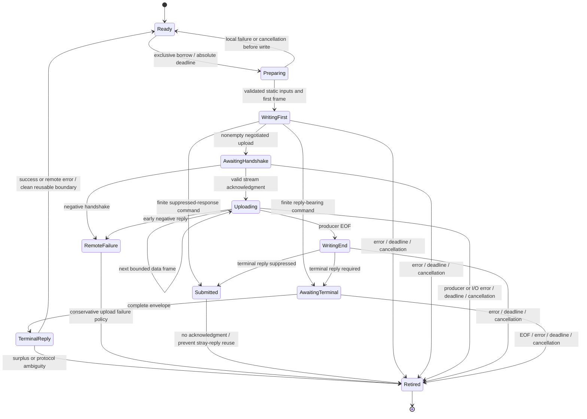
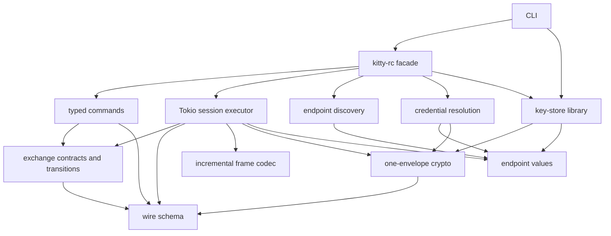

# Kitty-native exchanges from kubeless evidence

## Recommendation and standing

**Adopt kubeless's separation of invocation, native result, and later observation;
implement a kitty-specific exchange machine rather than depending on its HTTP
client or generic controller framework.** One exclusive connection owner, typed
commands, bounded persistent framing, and explicit upload completion address the
observed defects with fewer semantic moving parts than a resident multiplexing
driver. Fine-grained concern crates remain valuable even with this small executor.

This is the commissioned second contribution after [FX's reconnaissance](kubeless-assessment0.glm53fx.md).
The parent's independent initial draft and the same-wave tmax document were not
read. The supplied parent direction is a comparison target, not a decision already
made. All local interfaces are unstable; preserving legacy APIs or downstream
compatibility is not an objective. Upstream protocol interoperability still is.

Terms used here:

* **Exchange:** the entire command-specific conversation, including upload
  handshake, body chunks, explicit end marker, and terminal response if required.
* **Submission:** locally completing the prescribed outbound frames. This does
  not establish server execution or success.
* **Terminal response:** a complete server reply ending this exchange under its
  command contract; `ok: false` is a remote failure, not a transport failure.
* **Settlement:** an additional application-defined fact, such as observing a
  launched child exit. A generic `ok: true` is not evidence of every desired effect.
* **Retired connection:** an owned transport that will not be reused, whether
  because of uncertainty, cancellation, protocol failure, or deliberate close.

## 1. Evidence coordinates and opportunity matrix

Kubeless was read through `~/src/kubeless`, resolving to `~/src/kube-kubeless`.
`jj log` identifies the empty working copy as
`ee984da4af6a9772349129f8d98611450d378e87`, parent
`e1e4b63ac5045d2228b458f81ba52024a57bd803`; `jj diff --stat` was empty.
The separate Git HEAD reported `75e4dee2f45d16343428d6bb16cadd755c21bc6d`
and did not resolve the jj working-copy hash. **The jj snapshot is the source
coordinate used here**, not that misleading Git HEAD. Linked GitHub coordinates
identify source revisions, but remote publication of this local jj snapshot was
not verified; recover locally with jj when necessary.

Kitty archive HEAD was `5bf3c2dc676efd5c4b4526eb135c922701565707`.
A diff from stable `b2cb871254fbdac19a085188813c8dfb258b95cd` of
`rc/base.py`, `rc/run.py`, `rc/set_background_image.py`, and Go
`socket_io.go`, `run.go`, `set_window_logo.go`, `main.go` found only a
background-image documentation spelling correction. Dispatcher details below
were directly inspected at HEAD; the [upstream evolution report](../upstream-kitty/evolution0.gpt6a.md#2-protocol-encryption-and-sockets)
supplies the broader baseline comparison.

Kubeless paths in this table are relative to that snapshot. They identify exact
functions or tests so the claims remain inspectable beyond line-number drift.

| Opportunity | Source evidence actually inspected | Kitty application and limit | Reuse decision |
|---|---|---|---|
| Preserve invocation phase | `kube/client/src/client/response.rs:12–25`; `response/tests.rs::public_collection_retains_outer_readiness_phase_after_buffer_closes` | Outer `Service::call` invocation is not wire delivery. The test's first call is `Invoked` even though inner readiness fails. Use kitty transport-boundary evidence with honest names. | Independently implement kitty evidence types. |
| Retain evidence after decoding failure | `response.rs::request_bytes_with_evidence`; `public_collection_retains_head_when_body_read_fails` | HTTP has a separately received head; kitty has one JSON frame. Retain complete envelopes and bounded partial-frame diagnostics, never infer `ok` from a truncated JSON prefix. | Implement locally; no HTTP dependency. |
| Explicit replay permission | `client/retry.rs::RetryPolicy::{retry,clone_request}` and executed retry tests | Missing permission and service errors do not retry. Even a 503/504 response need not prove no upstream effect; this policy cannot justify kitty retries. | No automatic retry in initial executor. |
| Body duplicability versus replay policy | `client/body.rs::Body::try_clone` | `Kind::Once` **is** cloneable; wrapped streams are not. Ability to copy a body is not authority to repeat its effects. | Consume each prepared exchange once; avoid a replay trait initially. |
| One submission; acknowledgment retained separately | `control/settlement/src/lib.rs::acknowledge_then_settle`, `settle_acknowledged`; cancellation/receipt tests | Useful law, but the recipe submits once **when polled**, not remote exactly-once execution. Dropping it loses in-memory receipts. | Keep evidence in connection-owned exchange state; optional future settlement helper can depend directly on this crate. |
| Resolution rejection differs from native failure | `control/attempt/src/lib.rs::attempt`, `Outcome` | `Completed(Err(_))` is not `Rejected`. Its factory is invoked immediately on construction; it does not classify socket I/O. | Reimplement native result shape, not this wrapper merely to wrap `Result`. |
| Conditional recomputation | `operation/src/lib.rs`, `tests/bounded.rs`, `tests/observed.rs` | Fresh read/preparation only after source-native conflict. Kitty lacks the required conditional-write primitive in inspected commands. A preceding `ls` cannot manufacture CAS. | Do not depend or extract for the initial library. |
| Streaming data versus terminal status | `kube/client/src/api/remote_command.rs::start_message_loop`, `take_status`, `join`, `Drop` | Strong ownership precedent; Kubernetes channels and full-duplex exec are not kitty's protocol. Kitty `run` buffers input, then later returns stdout/stderr together. | Apply separation, not transport or task architecture. |
| Complete operation deadline | `client/builder.rs:226–303` | Connector read/write/connect timeouts are configured; this default stack supplies no end-to-end deadline around body production and decode. | New absolute-deadline contract at kitty exchange boundary. |
| Executor-free concern crates | `operation/Cargo.toml`; root README composition rules | `operation` has no normal dependencies; executor-free can still expose futures. Pure wire/schema/exchange decisions need no Tokio; sockets and timers do. | Use independent pure crates and a concrete Tokio adapter. |

### Corrections and qualifications to FX

FX correctly identified the important boundaries, the lack of a whole-operation
deadline, and the dangers of transplanting the HTTP stack. Specific corrections:

1. Its retry-body sentence reverses `Kind::Once`: that is the cloneable kind,
   not the refusal case. `Kind::Wrap` returns `None`.
2. “The server answered” is insufficient evidence for retrying an effect. The
   HTTP policy explicitly accepts statuses that can arise after an upstream
   request was forwarded. Kitty needs native command evidence and caller intent,
   not a translation of HTTP codes to error strings.
3. `AttachedProcess::join()` drops **retained** stream ends, not ends already
   handed to the caller with `.take()`. A caller holding an undrained stdout
   reader can still keep the background writer blocked. It also drops a retained
   status receiver: sending status can then fail with `Error::SendStatus`.
   Moreover the loop returns `Ok(())` on clean WebSocket EOF without any status.
   Thus task join, output drain, and remote outcome must remain separate.
4. `CollectedBody::ReadFailed` retains the head, not partial body chunks consumed
   before failure. Kitty's bounded partial diagnostics are additional design.
5. `operation` is not a safe generic check-then-act recipe without a source-native
   condition. The absence of kitty CAS is a decisive mismatch, not a small gap.
6. The current kitty manifest declares edition 2024 but **no `rust-version`**.
   Kubeless's declared 1.89 floor is concrete; calling it newer than a known kitty
   MSRV is unsupported. Select and test a floor rather than inheriting an assumption.

The dropped `write_all` inner result is already fixed at local `97990cb2`, where
`client.rs:199–201` uses `??`. The double-encryption, disposable receive buffer,
generic string chunking, and unchecked response semantics remain visible in the
source reread here. No claim about current kitty test/lint health follows from
the older 159-test result.

## 2. What kitty's streaming protocol actually requires

The decisive evidence is [the dispatcher][kitty-dispatch],
[stream accumulation][kitty-base], [background image][kitty-image],
[run][kitty-run], and the [Go socket exchange][kitty-socket].

### Three different operations, not “a large message”

| Operation | Outbound conversation | Completion |
|---|---|---|
| Finite command, e.g. `ls` | One complete envelope | One terminal response; `ls` data is itself a JSON string under the supported wire schema. |
| Image upload | First nonempty data frame requests stream acceptance; await `ok: true, stream: true`; subsequent data frames with the same stream ID do not request repeated handshakes; an empty `data` frame ends input | Final ordinary reply, unless supported no-response mode suppresses it. `data: "-"` and `index:N` are finite operations, not uploads. |
| `run` with stdin | Command-specific base64 chunks, stream ID, async ID under wire key `async`, input terminator | Async final `data` contains base64 stdout/stderr and exit status. This is **not live output streaming**. Nonzero child exit is a typed run result, distinct from envelope `ok: false`. |

`handle_cmd` returns the stream acknowledgment only when the handler returns an
`AsyncResponse` **and** the current envelope has `stream: true`. Intermediate
input is not command success. The Go client reads this acknowledgment before
pulling/sending the rest and turns off `Stream` on later chunks. A generic
“iterator of messages followed by one receive” cannot express this exchange.

The image specification says at most 512 raw PNG bytes per base64 chunk; its
Python generator uses 512. The Go image reader uses 2048, and the server's
`StreamInFlight` enforces a total-size limit rather than that per-chunk number.
Use the documented conservative chunk size in the initial Rust command profile
and record this reference-client divergence in fixtures. `run`'s Python and Go
readers use 4096 raw bytes. Do not reuse a universal 4096-character split rule.
Compute the actual framed/encrypted byte size too: metadata, JSON escaping,
base64 and base85 expansion count against outbound limits.

**EOF is command data, not a socket event.** A source's `None`/EOF causes exactly
one explicit empty payload where that command requires it. Empty chunks from a
user stream must not accidentally become protocol EOF: prefer byte-reader input,
or normalize empty producer chunks and reserve a distinct `EndInput` event.
Keep immutable target/options in every payload that the handler may inspect,
especially the final one. Never reconstruct a payload from only its largest
string. Never use lossy UTF-8 conversion; binary uploads are bytes before base64.

### Empty input, suppression, and early failure

The first data item needs bounded lookahead before choosing the exchange path.
An empty image terminator is handled immediately by the server, so it need not
produce a streaming acknowledgment. For an empty upload, set `stream: false`
and await its ordinary terminal result (or reject an invalid empty PNG locally
where possible). An empty `run` can likewise send its terminator with `async`
and no handshake flag, then await the async result. This avoids unconditionally
waiting for a handshake that a finite handler result never promises.

An upload's no-response option suppresses the **terminal result**, not necessarily
the handshake: `handle_cmd` returns the streaming acknowledgment before its final
`no_response` branch. Keep required handshake reads in the exchange plan.
Do not offer a universal `no_response` switch on arbitrary asynchronous commands:
`send_response_to_client` does not consult it. Initially admit suppression only
for audited command profiles; `run` remains reply-bearing.

A negative or malformed handshake stops production. During later upload writes,
the executor must be able to notice an early error rather than filling socket
buffers forever. A local producer error after accepted chunks produces an
incomplete/uncertain exchange, not an automatic empty terminator: finalizing
truncated input could execute the wrong command. Retire the transport.

### Two server facts that change concurrency design

1. Async IDs are server-side request/cancel keys, **not response correlation
   identifiers**. `send_response_to_client` removes an ID from its active map,
   then sends only `ok` plus `data` or `error`. One in-flight exchange per owned
   connection is the supported starting point. Local exchange IDs are diagnostic.
2. `RemoteCommand.__init__` creates one `StreamInFlight`; command modules expose
   singleton command objects. `StreamInFlight` holds **one** current stream ID
   and buffer; a different ID aborts its predecessor. Thus separate connections
   do not establish independent concurrent uploads of the **same command** to
   the same server. This source-level limitation merits a live regression test.

Consequently even a future connection pool must not promise server-wide upload
isolation. A caller coordinating multiple sessions can serialize uploads by
endpoint/command as a best effort, but endpoint strings can alias and unrelated
clients can interfere. No library lock can supply a server-native concurrency
guarantee absent from the protocol. Random stream IDs avoid accidental collisions;
they do not fix this shared accumulator. This is a stronger reason to avoid a
premature multiplexed driver than task-count preferences alone.

## 3. Exchange lifecycle: precise evidence, simple ownership

### Ownership and cancellation

Use `Session::execute(&mut self, ...)` with one transport owner. The persistent
frame decoder and write cursor belong to that owner, not to throwaway receive
futures. An internal guard temporarily owns the session's I/O bundle, returning
it only at a proven reusable boundary. On drop after I/O starts it synchronously
drops the transport and marks the session retired. It must not perform an async
drain or emit cancellation traffic from `Drop`.

Before the first transport write is polled, failures can say **NoWriteStarted**.
Mark **WriteStarted** immediately before entering that boundary. Treat subsequent
failures conservatively even if no completed write count is known. For the
concrete socket adapter, retain accepted byte/frame counts as additional local
evidence, not proof of server receipt. This avoids claiming `NotSent` for a
buffered/custom transport whose call may already have effects.

Dropping an unpolled operation has no submission effect. Dropping during purely
local preparation may return the untouched I/O bundle. Dropping after write
start retires it even if cancellation occurred while reading. Partial bytes are
never fed to a new command. Explicit timeout/error returns include the evidence;
future drop cannot return a synthetic `Err`. Keep a compact last-exchange
record in the session so its owner can inspect cancellation phase afterward.
That record is in-memory, bounded, and not a durable operation journal.

The local cancel guarantee is **stop driving and prevent reply misattribution**,
not “undo remote effects.” A separate explicit best-effort cancel API could
eventually send kitty's `cancel_async` request with the original `async` ID.
The default command hook is a no-op and removal of response delivery is not
process rollback. Closing the socket does not prove an upload accumulator or
remote task was cleaned up. Do not add automatic cleanup/reconciliation.

### State diagram



An empty-input upload chooses its finite/async terminal path in `Preparing`,
rather than traversing a fictitious handshake. `TerminalReply` decoding can
produce a typed success, a remote failure, or an output-schema failure with a
retained envelope. Output-schema failure is not automatically uncertain delivery:
`ok: true` may already be known even though typed data is unusable. Conservatively
retiring after a schema violation is acceptable initially.

A frame decoder **retains surplus**; the exchange machine decides whether that
surplus is permitted. Coalesced expected frames are consumed in order. Unexplained
data after the terminal boundary retires the session; it must not become the
next command's response. The first implementation has no unsolicited-response
subscription contract. Reuse therefore requires an audited command profile and
exclusive socket ownership, not merely a successfully parsed JSON object.

For successful no-response submission, deliberately retire the connection. This
also isolates commands whose server error paths unexpectedly reply despite
suppression. A fresh connection for a **new** command is not replay of the old
one. No-response returns local submission evidence only.

### Whole-exchange deadline

Take one absolute Tokio `Instant` at the public async entry, or accept one supplied
by the caller. It covers first-source read, per-frame preparation/encryption,
write readiness, handshake, later source reads, end marker, response, and decode.
Every suspension uses the same deadline; slow progress never refreshes it.
Setup has a distinct explicit budget; a facade offering `connect_and_execute`
must pass one budget through both stages if it promises one end-to-end limit.

An async timeout is cooperative: it cannot preempt synchronous serialization,
CPU-heavy decode, or a blocking callback. Bound work and sizes, check the deadline
before/after synchronous segments and between frames, and document that this is
not a hard real-time preemption guarantee. Do not claim victory merely by wrapping
one `write_all` or `receive` in `timeout`. Timeouts after I/O starts are unknown
effect outcomes with their last available evidence, not retry permission.

## 4. Proposed API and command/exchange seam

These are **uncompiled interface sketches**, not patch-ready signatures. The
important commitments are ownership, result distinctions, and avoiding a public
generic JSON-chunking interface.

```rust
pub trait Command {
    type Output;
    type Plan: ExchangePlan<Output = Self::Output>;

    fn prepare(self, context: &PrepareContext) -> Result<Self::Plan, PrepareError>;
}

// Only audited commands implement this; not a bool on every command.
pub trait Suppressible: Command {
    type SubmissionPlan: ExchangePlan<Output = Submission>;
    fn prepare_submission(
        self, context: &PrepareContext,
    ) -> Result<Self::SubmissionPlan, PrepareError>;
}

pub enum DeliveryEvidence {
    NoWriteStarted,
    WriteStarted { accepted_bytes: u64, complete_frames: u64 },
    OutboundComplete { complete_frames: u64 },
}

pub struct Receipt<T> {
    pub value: T,
    pub evidence: ExchangeEvidence,
}

pub struct Submission {
    pub evidence: ExchangeEvidence, // no terminal server acknowledgment
}

pub enum ExchangeFailure {
    BeforeWrite(PrepareOrSetupError),
    Remote { reply: RemoteFailure, evidence: ExchangeEvidence },
    InvalidOutput { reply: ReceivedReply, source: DecodeError },
    Unresolved { source: ExchangeCause, evidence: ExchangeEvidence },
}

impl Session {
    pub async fn execute<C: Command>(
        &mut self, command: C, options: ExecuteOptions,
    ) -> Result<Receipt<C::Output>, ExchangeFailure>;

    pub async fn submit<C: Suppressible>(
        &mut self, command: C, options: ExecuteOptions,
    ) -> Result<Submission, ExchangeFailure>;
}
```

`ExchangeEvidence` includes local exchange/connection tokens, last phase, local
write progress, optional accepted-stream acknowledgment, and an optional complete
terminal envelope. Do not present these as server-incarnation IDs. A remote error
also does not prove rollback: `Remote` records the server's negative answer, not
an assertion of zero effects. `ExchangeCause` preserves concrete I/O, source,
deadline, framing, crypto, and validation causes instead of converting all to text.
Retained raw replies/partial bytes need bounded storage and redacted diagnostics;
application data and passwords must not appear through routine `Debug`/tracing.

### Keep the initial plan vocabulary finite

Start with three plan forms: `SingleReply`, `SingleSubmission`, and
`UploadThenReply`/its audited terminal-suppression mode. Async terminal waiting is
metadata on a reply-bearing plan, not a response-routing map. A plan supplies:

* a typed payload/header constructor and response decoder;
* static validation and compatibility declaration;
* source bytes when applicable, a command-specific raw chunk bound, and
  invariants repeated in all payloads;
* handshake expectations, explicit end-input construction, and terminal rules.

Do not introduce a fully programmable exchange DSL simply to support these cases.
Represent their shared transition decisions in the exchange crate and command
details in the catalog. Add a new plan form only when a verified upstream command
cannot fit these semantics. Keep the plan trait internal/sealed initially; a raw
one-frame escape hatch may declare its reply policy explicitly and use the same
guard. Unsupported arbitrary raw multi-frame conversations require their own
owned transport, not a way to bypass invariants on a shared session.

The input-source adapter can expose an executor-free `Stream<Item = Result<Bytes,
E>>` using `futures-core`; a Tokio `AsyncRead` adapter belongs at the edge. Pull no
more than a bounded frame/lookahead at a time. Demand stops while waiting for the
handshake or socket capacity. This bounds client memory even though the server
buffers the entire `run` input and its eventual output.

Static validation can reject bad target syntax, impossible option combinations,
invalid public keys, unsupported response modes, and oversized fixed metadata
before I/O. Source errors, cumulative size violations, later frame serialization,
and per-frame crypto failures may occur afterward. Prepared does not mean the
whole unknown-length source has been validated or buffered.

### Typed outputs, exact envelopes, and encryption once

Examples: `LsJson -> Vec<OsWindow>`, `LsSession -> String`,
`SetFontSize -> ()`, `Run -> RunOutput { stdout: Vec<u8>, stderr: Vec<u8>,
exit_code, exit_status }`. Separate screenshot-to-bytes from server-path
screenshot results rather than returning one ambiguous string type.
`ok` and required command data must be present; missing `ls.data` cannot become
an empty successful listing. Unknown additive fields remain tolerated or retained
where the upstream schema is open. Preserve real list-valued `cmdline`/keys and
wire names such as `action`, `type`, and `async` in typed serialization fixtures.

Use distinct `PlainRequest` and `ProtectedEnvelope` types. The only outbound
path is:

```text
typed payload + envelope fields
  -> PlainRequest
  -> protection mode (plain OR encrypt once with injected time/randomness)
  -> ProtectedEnvelope
  -> bounded DCS frame encoder
  -> transport write cursor
```

The transport accepts framed bytes, never a `KittyMessage` that it might encrypt
again. Every upload frame, including terminator and any explicitly requested
cancel envelope, gets fresh per-message crypto material. Version is centralized
as the actual wire array; response encryption is not implied. Select declared
upstream support targets from conformance evidence, not from whichever kitty
version is newest. This is a protocol policy separate from local API stability.

## 5. Concern crates, setup decomposition, and runtime boundaries

### Preferred grouping: protocol, execution, environment

Package names below are proposals. Direct leaf dependencies are the contract;
`kitty-rc` is a convenience facade, not a mandatory center.

| Domain/path | Proposed crate | Responsibility and ordinary dependencies |
|---|---|---|
| `protocol/schema/` | `kitty-rc-schema` | Envelope/response types, version representation, schema errors; serde, serde_json. No I/O. |
| `protocol/frame/` | `kitty-rc-frame` | Incremental DCS parsing, exact surplus retention, frame limits; bytes if useful. No auth, commands, runtime. |
| `protocol/exchange/` | `kitty-rc-exchange` | Transition decisions, plan contracts, evidence and command trait; schema, optionally futures-core/bytes. No clock reads or spawning. |
| `protocol/commands/` | `kitty-rc-commands` | Typed command inputs/outputs and exchange profiles; schema, exchange, base64. PNG conversion and filesystem reads stay outside. |
| `security/crypto/` | `kitty-rc-crypto` | Key parsing and one-envelope protection with explicit credentials/time/randomness; schema and crypto primitives. No store or subprocess. |
| `environment/endpoint/` | `kitty-rc-endpoint` | Address parsing, endpoint value types and source/provenance records; std. Paths retain native representation. |
| `environment/discovery/` | `kitty-rc-discovery` | Enumerate configured OS/env sources, return candidates and diagnostics; endpoint. Enumerating is I/O, selection can be pure. |
| `security/credentials/` | `kitty-rc-credentials` | Credential source values, precedence/policy and resolved provenance; crypto key types, endpoint as needed. Explicit env/file readers are I/O adapters, not crypto. |
| `security/key-store/` | `kitty-rc-key-store` | Parse and read/write stored public-key records; crypto key types and endpoint association metadata. No CLI or discovery dependency. |
| `execution/tokio/` | `kitty-rc-tokio` | Concrete socket/session owner, incremental read/write, deadlines, input adapter; endpoint, exchange, schema, frame, crypto, Tokio. No default discovery or store lookup. |
| `client/` | `kitty-rc` | Re-exports and optional setup composition; commands, Tokio execution, opt-in discovery/credentials/store. |
| `cli/` | `kitty-rc-cli` | Argument/env policy, formatting, key-store utility, executable entrypoints; facade and shared setup/store crates. |



Credential resolution receives explicit store lookup results through composition;
it need not import a filesystem store. Likewise a store does not enumerate live
processes to decide what to delete. Separate environment enumeration, endpoint
selection, key lookup, credential resolution, crypto preparation, connection, and
exchange invocation in both APIs and error reporting. The current library's
`Command::new("kitty-pubkey-db")` path disappears; the CLI calls the same store
library that higher-level setup uses.

### Alternative grouping: capability families

A coherent alternative places `wire/{schema,frame,crypto}`,
`command/{catalog,exchange}`, `connection/{endpoint,tokio}`,
`setup/{discovery,credentials,key-store}`, and `app/{client,cli}`.
The dependency graph remains the same. This groups code by a caller's journey;
the preferred layout groups security and environment responsibilities for
independent reuse. Both avoid a flat pile of crates. The human should select
names/layout deliberately; crate count is not an architectural quality metric.

Pure transition code does not need a generic clock abstraction: the host can
report `DeadlineExpired` as an event. The initial executor should be honestly
Tokio-specific, with narrow `net`, `io-util`, `time` and necessary runtime features,
not `full` by default. `Session<T>` over `AsyncRead + AsyncWrite + Unpin` can aid
tests and caller-supplied streams; the standard Unix-socket constructor establishes
clear concrete behavior. No Tower middleware stack is needed.

During upload, a single future can drive inbound frames, a pending outbound
frame, and the producer. Keep the outbound offset and decoder state in the I/O
bundle. Select among cancellation-safe primitive reads/writes, not disposable
`write_all` operations with hidden progress. Bound producer polling and inspect
inbound terminal errors between frames. A background task or separate channels
are unnecessary for this finite upload protocol. TTY ownership/raw-mode routing
and TCP constructors are distinct transport work, added with native conformance
tests rather than silently treated as Unix sockets.

Persisted key-store records deserve an explicit format decision independently
of unstable Rust APIs: parse current records and report malformed ones; do not
silently erase user data. A PID guessed from a filename, a stored timestamp, and
a locally assigned connection token are lookup hints, not proof of server
incarnation or key freshness. Re-resolve credentials when constructing a new
session under caller-selected policy. Missing credentials and malformed or stale
records are distinct outcomes; avoid hidden downgrade from requested encryption.
The old CLI has cleanup-on-add behavior; do not carry that into library reads or
automatic reconnection. Cleanup remains a separate deliberate action.

## 6. Dependency, extraction, and reimplementation decisions

**Initial recommendation: no direct kubeless dependency and no copied implementation.**
Its important contributions here are contracts; the required kitty machinery is
small but protocol-specific. Depending on a generic crate merely to name two
outcomes adds an unpublished moving contract without buying the framing,
correlation, suppression, or cancellation guarantees we need.

| Candidate | Direct dependency | Extraction/copy | Recommended use / expansion trigger |
|---|---|---|---|
| `kubeless-control-attempt` | Technically usable, executor-free | Little gain from copying its wrapper | Native preparation/result taxonomy now. Consider direct use only in a later generic action host with resolution factories. |
| `kubeless-control-settlement::acknowledge_then_settle` / `settle_acknowledged` | Genuinely usable for caller-defined post-ack observation | Avoid maintaining a second copy | Optional future recipe crate if there is a concrete predicate and truthful target identity; retain receipt through ordinary errors, document drop loss. |
| `kubeless-operation` | Technically lightweight, semantically wrong for kitty's unconditional commands | Does not create missing server CAS | Only if a future backend exposes actual conditional writes/conflicts; never label read-then-set as equivalent. |
| Observation session/backoff/view wait | Not needed for finite RC exchanges | No extraction justified | Revisit for a separately commissioned observation service, with native resumability evidence or honestly labeled polling. |
| Keyed futures/work executor | Additional scheduling owner absent from this design | No extraction justified | Revisit for a multi-session host needing keyed admission; still cannot guarantee isolation from external uploaders. |
| HTTP phase/retry/collection code | Pulls HTTP/Tower semantics | Stripping it would mostly rewrite it | Independently implement evidence retention and one-shot guard against kitty transport boundaries. |
| `AttachedProcess` | Kubernetes WebSocket semantics and spawned task are wrong | Copies the wrong lifecycle | Use its task/status distinctions to design tests, not a kitty wrapper pretending to have live stdout channels. |

Kubeless declares Apache-2.0, edition 2024, Rust 1.89, unpublished internal
packages and revision-pinned checkout consumption. A future direct dependency
needs an actually fetchable reviewed commit and feature/dependency/MSRV checks,
not an unverified GitHub link to a local-only commit. Its generic source is not
a guaranteed stable standalone API just because it compiles without Kubernetes.
Do not infer maturity from inherited kube-rs branding: fork-specific boundaries
were verified here, but their upstream ancestry was not.

If substantial Apache-licensed source is copied later, preserve applicable
copyright/license/NOTICE material and mark modifications rather than relabeling
it MIT. The kitty Python/Go source read for protocol behavior is GPLv3; this
proposal calls for an independent Rust implementation of observed wire behavior,
not translation/copying of those implementations. Existing MIT project licensing
does not settle the treatment of future copied code or test fixtures.

## 7. Failure-focused conformance and minimal landing sequence

### What was verified in this research

Executed in kubeless's source snapshot:

```sh
cargo nextest run -p kubeless-control-settlement -p kubeless-operation --no-fail-fast
cargo nextest run -p kubeless-kube-client -E 'test(client::response::tests::) | test(client::retry::tests::)'
```

Both succeeded: 36 selected settlement/operation tests and 17 selected
response/retry tests. Relevant exercised properties include receipt loss on
cancellation, submit-once, terminal uncertainty after a mutation, fresh conflict
recomputation, response-head retention, finite-body collection once, non-eager
streaming, and permission-gated retry. The manifests emitted existing
missing-lints-inheritance warnings for e2e/examples. These results verify those
specific mechanisms under their tests; they do not validate this unimplemented
kitty design. No `AttachedProcess` integration test, real kitty test, whole
workspace lint, or Rust-sketch compile was run.

### Tests needed for the proposed implementation

| Boundary | Adversarial cases and assertions |
|---|---|
| DCS codec | Every split of prefix/suffix, partial UTF-8, two frames in one read, one complete plus partial frame, bytes after terminal, EOF mid-frame, bounded junk policy, oversized frame without unbounded allocation. Return one frame and retain exact remainder. |
| Finite exchange | `ok: false` never typed success; missing `ok`/required data is an error; `ls` string parsing; malformed nested output retains complete envelope; additive fields tolerated. |
| Cancellation | Drop before first poll, during first source read, at each partial write, during handshake, after partial reply, after handshake with producer pending. Next exchange cannot reuse abandoned transport. Cancellation does not synthesize a returned receipt. |
| Deadlines | Slow trickle reads/writes and stalled producers exceed the same original deadline; no per-chunk resets. Pre-write expiry proves no write started; later expiry preserves uncertainty. |
| Upload | Empty, small, exact-boundary and multi-chunk bodies; target/options preserved on all frames; exactly one command EOF marker; only first nonempty chunk asks handshake; rejection stops production; late source error does not finalize truncated data. |
| No-response | No terminal read for finite suppressed commands; negotiated image upload still reads handshake; submitted result is not remote success; transport retired; unsupported async suppression rejected before writing. |
| Crypto | Plain/protected type separation, encrypt once per frame, new IV material, intact envelope fields including `async`, cross-language vectors for key/base85/timestamp/payload; no subprocess/store access in crypto. |
| Server behavior | Async response lacks correlation ID; delayed reply after cancellation never reaches a later command; same-command interleaved uploads exercise singleton accumulator behavior. Verify stable plus chosen older target and separate provisional HEAD cases. |
| Setup/store | Explicit endpoint needs no enumeration; malformed versus missing credentials; endpoint aliases and PID reuse; no implicit prune; shared CLI/library parser; errors retain their native causes. |

Use an in-memory scripted transport for precise fault placement, then a fake
Unix server for stream scheduling and socket-close behavior. Finally run real
kitty/`kitten @` conformance under controlled fixtures. Derive fixture expectations
from pinned protocol/server sources, not round-tripping the Rust implementation
against itself. For inbound size policy, test large `ls`, get-text, screenshot,
and `run` output: the server's cited 64-KiB **request** buffer is not an inbound
response limit. Choose explicit configurable response and total-upload bounds;
the inspected upload accumulator's 128-MiB cap is a server ceiling, not a reason
to allocate that much by default.

### Coherent implementation stages if accepted

1. Establish the leaf crates and one end-to-end finite typed exchange (`ls` plus
   a unit-result mutation). Make framing, single protection, guard, deadline,
   and response failure semantics correct together. Expose explicit endpoint
   and credentials so setup convenience cannot obscure protocol behavior.
2. Decompose environment/discovery, credential resolution and shared key store;
   compose the facade and CLI through those public seams. Account explicitly for
   persisted records rather than preserving the old subprocess boundary.
3. Add a real image upload profile with handshake and terminator fault tests;
   then `run` to exercise input plus async terminal output. This validates the
   common plan machinery against distinct contracts before migrating every
   command. Audit suppression per command, not globally.
4. Migrate the remaining catalog with source-backed wire fixtures and explicit
   typed outputs. No compatibility wrappers are required. Extend plan vocabulary
   only on demonstrated protocol need.

Expansion triggers are concrete: a verified live output protocol may justify a
borrowed event stream and later a task-owning handle; multiple independent
connections may justify an admission host; a native subscription cursor may
justify observation/session reuse; a source-native conditional mutation may
justify `kubeless-operation`. None is implied by large payload size or the desire
for more crates. Retrying side effects, automatic state reconciliation, and
automatic cleanup remain separate human decisions.

## 8. Questions for synthesis and human discussion

1. **Default connection lifetime:** persistent for audited reply-bearing commands
   with a retirement guard, or one connection per exchange? Both avoid ambiguous
   multiplexing; the latter simplifies lifetime further at the cost of more setup.
   Recommendation: persistent explicit `Session`, with a one-exchange facade
   convenience and mandatory retirement after suppression/uncertainty.
2. **How much cancellation evidence should survive the future?** A compact
   session-owned last record supports inspection after `select!` cancellation.
   Durable receipts or recovery across process loss require a separate owner and
   storage contract. Recommendation: only the compact in-memory record initially.
3. **Public extension seam:** sealed audited plans plus explicit raw finite
   exchange, or a public low-level exchange machine for custom commands?
   Recommendation: keep machine internals revisable until image and `run`
   conformance establishes the useful abstraction.
4. **Upload interference:** how prominently should the facade expose the
   server's same-command single accumulator? Recommendation: document it as an
   upstream constraint, test it live, and avoid promising cross-session isolation.
   A local scheduler can help cooperating clients but cannot solve it universally.
5. **Runtime and upstream support floor:** select a tested Rust minimum and
   declared kitty support range. Pure crates need not inherit Tokio; executor-free
   does not require inventing multiple runtime adapters now.
6. **Settlement helpers:** is there an immediate caller need to prove a fact
   beyond the command's native terminal response? If so, define that predicate
   and evidence first, then assess direct `kubeless-control-settlement` reuse.
   “Wait until it worked” is not yet a sufficient identity or settlement contract.

## Cross-references

* [FX reconnaissance](kubeless-assessment0.glm53fx.md) supplies the authorized
  opportunity inventory; this contribution tightens its reuse decisions and
  corrects its body-cloning and streaming-lifecycle overstatements.
* [Upstream evolution](../upstream-kitty/evolution0.gpt6a.md) is the independent
  source for baseline/support-version context. Its protocol stability findings
  reinforce fixing existing semantics before globally bumping wire versions.
* [Library redesign home](README.md) is the parent's integration point. This
  contribution neither updates that owner-maintained index nor reads the
  restricted same-wave drafts; reciprocal/index maintenance belongs to synthesis.

[kitty-dispatch]: https://github.com/kovidgoyal/kitty/blob/5bf3c2dc676efd5c4b4526eb135c922701565707/kitty/remote_control.py#L215-L265
[kitty-base]: https://github.com/kovidgoyal/kitty/blob/5bf3c2dc676efd5c4b4526eb135c922701565707/kitty/rc/base.py#L295-L326
[kitty-image]: https://github.com/kovidgoyal/kitty/blob/5bf3c2dc676efd5c4b4526eb135c922701565707/kitty/rc/set_background_image.py
[kitty-run]: https://github.com/kovidgoyal/kitty/blob/5bf3c2dc676efd5c4b4526eb135c922701565707/kitty/rc/run.py
[kitty-socket]: https://github.com/kovidgoyal/kitty/blob/5bf3c2dc676efd5c4b4526eb135c922701565707/tools/cmd/at/socket_io.go#L120-L161
